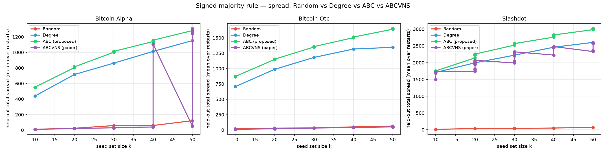
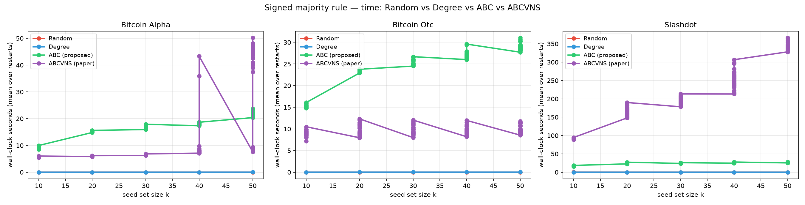
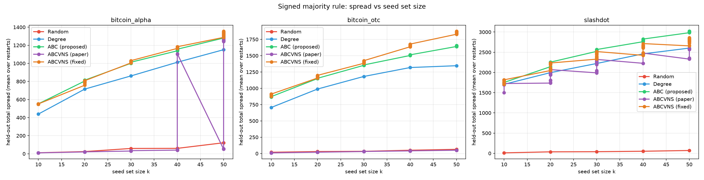
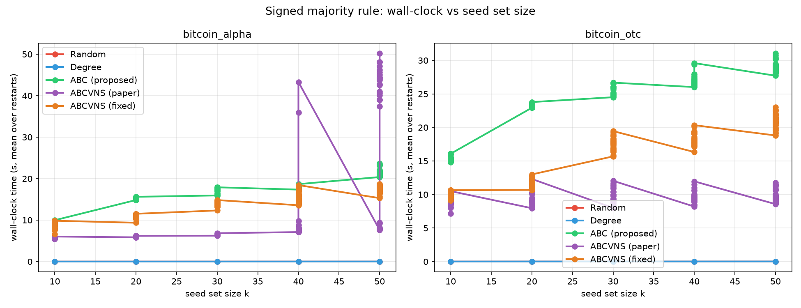

# Presentation content — Influence Maximisation on Signed Networks

**Our optimised Artificial Bee Colony (ABC) vs the ABCVNS paper algorithm**

Bitcoin Alpha · Bitcoin OTC · Slashdot · k = 10–50 · 30 restarts

> Every slide below is written in plain English with examples, in the order we
> want to present it. Figures are embedded at the end of the relevant slides.

---

## Slide 1 — Title

**Influence Maximisation on Signed Networks**
Our optimised Artificial Bee Colony (ABC) vs the ABCVNS paper algorithm

- Majority-rule diffusion on signed trust networks
- Bitcoin Alpha (3,783 nodes), Bitcoin OTC (5,881), Slashdot (82,140)
- k = 10, 20, 30, 40, 50 seeds
- 30 independent restarts per algorithm
- CPU + GPU implementation (numpy / CUDA)

---

## Slide 2 — The majority rule model (in plain English)

**The idea in one sentence:** a person "switches" only when more than a personal
fraction of their friends have already switched.

**The rule for a node v:**

    Σ w(active friends)  −  Σ w(active enemies)  >  θ_v × deg(v)

**Code — one round of the simulation (vectorised over R random runs):**

```python
# counts = signed net support per node, per random run
counts = A_signed.dot(active)              # Σ +w from active friends − Σ w from active enemies
newly  = (counts >= need) & (~active)      # need = floor(theta_v * deg_v) + 1
active |= newly                            # progressive: nodes never deactivate
```

- `deg(v)` = total weight of all edges touching v.
- `θ_v` = v's personal threshold, redrawn every run from U[0.35, 0.65]
  (i.e. 0.5 ± 0.15).
- Friends push v's support UP; enemies push it DOWN.
- Once active, a node stays active forever.

**Worked example:** v has 10 friends (weight 1 each), of which 4 are active
friends and 1 is an active enemy.
- Net support = 4 − 1 = 3.
- If θ_v = 0.5, v needs more than 0.5 × 10 = 5.
- 3 is not > 5 → v stays inactive.
- If two more friends switch on, net support = 5 — still not strictly above 5.
  One more friend (net 6) finally activates v.

**Why this model is interesting (and hard):**
- Adding an **enemy** seed can *reduce* the spread. On a tiny toy graph,
  σ({1,2,3,4}) = 6 but σ({1,2,3,4,5}) = 5 — more seeds is not always better.
- One extra seed almost never flips anyone alone. Influence is a property of
  **whole teams (coalitions)**, not of individual nodes.

---

## Slide 3 — Why an Artificial Bee Colony over the current methods

**Greedy and CELF think one node at a time.** They judge each candidate by its
solo contribution.
- Example: friend A alone cannot flip the hub, friend B alone cannot either
  (gain 0 for both). Greedy sees two "useless" nodes and picks blindly — but
  {A, B} together would flip the hub. Greedy cannot see teamwork.

**CELF's shortcut is invalid here.** CELF assumes that adding a node later can
only help less (submodularity). Under majority rule that is false, so we run
CELF as a fast guess and **audit** every shortcut; the violations are recorded
in the result files.

**SA and GRASP** are decent baselines, but SA spends most of its budget on
temperature ramps and neither one reasons about coalitions.

**ABC searches whole teams at once.** A colony of candidate k-sets keeps
combining, copying and replacing complete teams — a population of team
proposals improving over generations.

**Our safety net:** the colony starts from CELF's best team, so ABC can never
finish worse than CELF. CELF supplies the gradient; ABC supplies the global,
team-level search.

**Code — the audited CELF shortcut (why it is only a heuristic here):**

```python
neg_gain, v, last_round = heapq.heappop(heap)     # most promising stale bound
if last_round == len(S):                          # bound was computed on the
    S.append(v); cur += -neg_gain                 # CURRENT set -> accept as-is
else:                                             # stale bound -> re-evaluate
    new_gain = model.sigma(S + [v]) - cur
    if new_gain > stale[v] + 1e-9:
        violations += 1                           # submodularity violated!
    heapq.heappush(heap, (-new_gain, v, len(S)))
```

**Code — the ABC main loop (whole teams, not single nodes):**

```python
for cycle in range(1, cfg.max_cycles + 1):
    employed_bees()      # every source mixes with a partner
    onlooker_bees()      # tournament-selected sources do the same
    scout_bees()         # abandon + rebuild stagnant sources
    dedupe()             # drop duplicate teams
    update_elitism()     # remember the best team ever seen
    maybe_refine()       # budget-capped local exchange (off in real runs)
```

> Measured on real networks: ABC stays within 1% of Greedy's spread at
> 0.44–1.16× the time, beats CELF by up to +7.3% (Slashdot k=20), and beats
> Degree by +13…28% on the signed Bitcoin graphs.

---

## Slide 4 — Weakness 1 of 9: weak exploitation → gbest-guided partners

**The problem (with an example).** Classic ABC updates a team by mixing it with
a *random* partner. Late in the search most partners are worse than the best
team, so the moves become random noise and the colony stops improving.
*Example:* the best team is {2,7,9}; a bee at {3,7,9} mixes with a random
partner {5,8,9} — the "difference" it learns (2→3, 7→8) is meaningless.

**Our approach.** With probability `gbest_prob = 0.6` the partner is the
**global-best team** instead. The bee now mixes with {2,7,9} and can directly
copy node 2 — every move becomes a deliberate step towards the best answer
found so far. The other 40% of moves keep exploring with random partners.

**Code — partner choice in the employed/onlooker phase:**

```python
if rng.random() < cfg.gbest_prob:          # 0.6
    partner = best_set                      # gbest-guided pull
else:
    partner = population[rng.integers(n_sources)]   # random partner
cand = _candidate(population[i], partner, pool, k, rng, cfg)
```

**If it is not configured well.** `gbest_prob` too high → every bee copies the
best team and the colony collapses onto one answer (exploration dies, the
search sticks in the first good basin). Too low → nothing changes from classic
ABC and the late-run crawl returns.

---

## Slide 5 — Weakness 2 of 9: roulette-wheel collapse → tournament onlookers

**The problem (with an example).** Classic onlooker bees pick a food source
with probability proportional to fitness. On zero-gain plateaus the fitnesses
are nearly identical — 0.900, 0.901, 0.902 — so the roulette wheel gives all
three almost equal chances and the slightly better source gets almost no extra
attention. The selection becomes a coin flip exactly when guidance is needed.

**Our approach.** Tournament selection: grab `ts = 4` sources at random and let
the **best of the four** win. A source that is better by even a hair wins most
of its tournaments, so small advantages get amplified. Roulette is kept as an
option, not the default.

**Code — tournament selection:**

```python
def _pick_sources(fitness, rng, cfg):
    n = len(fitness)
    picks = rng.integers(n, size=(n, cfg.tournament_size))      # ts = 4
    winners = picks[np.arange(n), np.argmax(fitness[picks], axis=1)]
    return winners                     # one winner per onlooker
```

**If it is not configured well.** Tournament size too big (close to the whole
population) → the single best source always wins — the same premature collapse
as roulette, just faster. Size 2 → almost no selection pressure, back to
coin-flip behaviour.

---

## Slide 6 — Weakness 3 of 9: blind scout restarts → directed scouts

**The problem (with an example).** When a bee's team stops improving for
`limit` cycles it is abandoned, and classic ABC throws it away for a completely
*random* new team — like tearing down the house and rebuilding from scratch
every time one room gets stuck. All the good parts the bee had collected are
lost.

**Our approach.** Directed scouts rebuild **near the incumbent** (Kiran &
Findik 2015): take the current best team and perturb it strongly (`n_mod = 2`
swaps, every slot re-rolled) — "fix the broken chair instead of buying a new
one". Only with probability 0.3 does a scout do a fully random reset.

**Code — directed scout:**

```python
if trials[i] > cfg.limit and budget_left():
    if cfg.directed_scout and rng.random() < 0.7:
        cand = _neighbour_solution(best_set, best_set, pool, k, rng,
                                   ABCConfig(n_mod=2, mutation_rate=1.0))
    else:
        cand = rng.choice(pool, size=k, replace=False).tolist()
```

**If it is not configured well.** If the incumbent is a local optimum, directed
scouts just orbit it and the colony loses its only escape route (the 30% random
reset is what keeps exploration alive). On very rugged landscapes you may need
to *raise* the random-reset probability back towards 0.5.

---

## Slide 7 — Weakness 4 of 9: one-size-fits-all perturbation → modification-rate control

**The problem (with an example).** A fixed-strength move cannot fit every
problem. For k = 50, changing 1 node out of 50 barely moves the team (a tiny
step); for k = 10, changing 1 node out of 10 is already a large step. One
recipe cannot serve both scales.

**Our approach.** Modification-rate control (Akay & Karaboga 2012): each move
performs `n_mod = 1` partner-guided swaps **plus**, with probability
`mutation_rate = 0.2`, one extra purely random swap. `n_mod` controls the step
size; `mutation_rate` injects the diversity that keeps the colony from
freezing.

**Code — partner-guided swaps plus a random mutation:**

```python
for _ in range(max(1, cfg.n_mod)):                 # n_mod = 1
    only_i = [v for v in xs if v not in partner_set]
    only_j = [v for v in partner_set if v not in xs]
    if only_i and only_j:                          # inherit from partner
        xs[xs.index(rng.choice(only_i))] = rng.choice(only_j)
    if rng.random() < cfg.mutation_rate:           # 0.2 extra random swap
        xs[xs.index(rng.choice(xs))] = rng.choice(
            [v for v in pool if v not in xs])
```

**If it is not configured well.** `mutation_rate` too high → every move is
effectively a random team and σ keeps dropping (no exploitation). `n_mod` too
high → children barely resemble their parents, so good coalitions are never
inherited — the search becomes a lottery.

---

## Slide 8 — Weakness 5 of 9: duplicate teams → dedupe

**The problem (with an example).** Different bees can drift onto the *same*
team — three bees all end at {1,4,8}. The colony then carries three copies of
one idea: its real diversity is far below what its size suggests, and every
evaluation on a duplicate is wasted.

**Our approach.** Dedupe: after each cycle, any exact duplicate team is
replaced by a fresh sign-aware biased team (net-positive-support sampling). The
number of replacements is counted and reported in the result CSVs, so the
effect is measurable.

**Code — duplicate suppression:**

```python
seen = set()
for idx in range(n_sources):
    key = frozenset(population[idx])
    if key in seen:                          # duplicate team
        population[idx] = _biased_set(model, pool, k, rng)
        fit_pairs[idx] = fitness_of(population[idx])
        dup_replacements += 1
    seen.add(key)
```

**If it is not configured well.** Exact-equality checks miss near-duplicates —
teams sharing 9 of 10 members still crowd the same region. An overlap-based
check would catch those but costs population² comparisons per cycle, which is
why the default stays exact-only on large runs.

---

## Slide 9 — Weakness 6 of 9: refinement eating the budget → reserve + caps

**The problem (with an example).** The 1-opt refinement re-evaluates many
candidates per pass: on k = 50 with a 200-node pool one pass can cost ~200
evaluations, and several passes can silently consume the *entire* evaluation
budget — leaving nothing for the colony that is supposed to do the global
search.

**Our approach.** Reserve 15% of the budget for refinement
(`reserve_fraction = 0.15`); every refinement call receives only what is
*left* of the budget (never more); and a `stagnation_limit` can end the whole
run early when nothing has improved for many cycles. In the real-network runs
refinement was switched off (`refine_every = 0`) and the whole budget went to
the colony.

**Code — reserve and hard cap:**

```python
reserve = cfg.reserve_fraction if cfg.refine_every else 0.0   # 0.15
soft_budget = cfg.eval_budget * (1.0 - reserve)

def remaining():
    return max(0, cfg.eval_budget - spent())

S2, f2, stats = celf_exchange_refine(
    model, best_set, pool,
    eval_budget=remaining(),          # never more than what is left
    lazy=cfg.lazy_refine)
```

**If it is not configured well.** Reserve too small → refinement starves and
the final polish disappears. Reserve too big → the colony starves and the
search degrades into a local hill-climber that cannot escape basins — the exact
failure ABC was designed to avoid.

---

## Slide 10 — Weakness 7 of 9: the flat plateau → the Φ gradient (σ + λ·Φ)

**The problem (with an example).** On plateaus σ is identical for many
different teams — dozens of sets all score σ = 100 — so the colony cannot tell
which direction is uphill and stalls on a flat map. *Example:* two teams differ
by one node, both score 100; classic ABC treats them as equal and wanders.

**Our approach.** Add the plateau potential
Φ = Σ min(1, net_v / need_v): how *close* every inactive node is to flipping at
convergence. It is computed in the **same cascade pass** as σ, so it costs
nothing extra. Fitness becomes `σ + λ·Φ` (λ = 0.05) — the flat map gets contour
lines. `accept_equal` lets bees slide along exact ties, and `explore_prob =
0.15` injects fresh random teams.

**Code — the plateau-aware fitness and accept rule:**

```python
def fitness_of(team):
    sigma, phi, sem = model.sigma_potential(team)   # ONE cascade pass
    return sigma, sigma + cfg.potential_weight * phi, sem   # λ = 0.05

def accept(new_sigma, new_phi, new_sem, i):
    tol = cfg.tol_mult * max(fit_pairs[i][2], new_sem)   # MC noise
    if new_sigma > fit_pairs[i][0] + tol: return True
    if abs(new_sigma - fit_pairs[i][0]) <= tol:          # plateau tie
        return new_phi > fit_pairs[i][1] + 1e-9
    return False
```

**If it is not configured well.** λ too big → bees chase Φ instead of σ and
can accept a team with *worse* actual spread (the fix overshoots into changing
the objective). λ too small → the plateau stays flat and nothing improves. λ
is the single most sensitive knob in the whole design.

---

## Slide 11 — Weakness 8 of 9: stale refinement → adaptive gating

**The problem (with an example).** Once 1-opt has polished the best team,
further refinement passes keep burning evaluations while making *zero* swaps —
pure waste, repeated every `refine_every` cycles for the rest of the run.

**Our approach.** Adaptive gating: count consecutive refinement passes that
made zero swaps; after **two** of them, refinement switches off for the
remainder of the run and its reserved budget returns to the colony.

**Code — adaptive refinement gating:**

```python
if cfg.refine_every and refine_active and cycle % cfg.refine_every == 0:
    S2, f2, st = celf_exchange_refine(...)
    if f2 > best_fit:
        best_fit, best_set = f2, list(S2)
    if st["refine_swaps"] == 0:        # a dry pass
        zero_refines += 1
        if zero_refines >= 2:          # two dry passes -> stop refining
            refine_active = False
```

**If it is not configured well.** The gate can switch off too early: the colony
may later move the incumbent into a region where 1-opt *would* help again, and
the gate has no way to reopen. That is one reason the real-network runs used
`refine_every = 0` and let the colony do everything.

---

## Slide 12 — Weakness 9 of 9: coalitions 1-opt cannot repair → cascade-aware swaps + 2-swap

**The problem (with an example).** Some coalitions need *two* seeds together to
work: hub H activates only if **both** A and B are seeded, so σ({A}) = σ({B}) =
0 but σ({A,B}) = 10. 1-opt tries one replacement at a time, sees zero gain for
each, and wrongly concludes the team is already optimal.

**Our approach.** Two weapons.
1. **2-swap shaking:** after 1-opt stalls, try replacing *two* seeds at once
   (up to 400 random attempts) — the pair {A,B} can finally be discovered.
2. **Cascade-aware candidates:** restrict swap-ins to neighbours of the current
   seeds and of near-threshold nodes, so the candidate list is short and every
   try is relevant.

**Code — 2-swap shaking and cascade-aware candidates:**

```python
# (a) try replacing TWO seeds at once when 1-opt stalls
for _ in range(two_swap_tries):                      # 400 attempts
    out_pair = rng.choice(len(S), size=2, replace=False)
    ins_pair = rng.choice(len(outside), size=2, replace=False)
    S2 = [v for i, v in enumerate(S) if i not in out_pair]
    S2 += [outside[i] for i in ins_pair]
    if model.sigma(S2) > best + 1e-9:
        S, best = S2, model.sigma(S2)
        break

# (b) restrict swap-ins to cascade-relevant nodes
def _cascade_cands(model, S_minus, cands, cap):
    relevant = set(neighbours of every seed)
    relevant |= set(neighbours of near-threshold nodes)   # slack <= 1
    out = [v for v in cands if v in relevant]
    return out[:cap] if len(out) >= 4 else list(cands)    # fallback
```

**If it is not configured well.** 2-swap is random sampling — if the winning
pair is rare, 400 attempts can miss it. And cascade-aware restriction can hide
a needed distant node; the code falls back to the full pool when it finds too
few candidates, which trades speed back for completeness.

---

## Slide 13 — ABCVNS: the paper's algorithm, in plain English

**Reference:** Tang, Dong, Wu, Chen & Wei, *Swarm and Evolutionary Computation*
105 (2026) 102404.

**One-sentence idea:** search whole k-teams with a bee colony, but score every
team with a **cheap closed formula (LIE)** instead of running simulations —
that is why it is fast, and also why it is model-specific.

**LIE example.**
LIE(S) = k + (1 + p × average two-hop bonus) × (expected one-hop activations).
One hop: each neighbour i of S flips with probability 1 − (1−p)^c_i, where c_i
= how many seeds touch it. With c_i = 2 and p = 0.05, that is 9.75%. The
two-hop term rewards **dense rings** around S — great for Independent Cascade,
not for majority rule.

**Code — the LIE fitness (Eq. 2 of the paper):**

```python
def lie_fitness(st, S):
    s = one_hot(S)
    cnt  = st.dot(s)                             # seed-neighbours per node
    n1   = (cnt > 0) & (s == 0)                  # one-hop shell
    sig1 = ((1 - (1 - st.p) ** cnt[n1]).sum())   # expected one-hop flips
    n2   = (st.dot(n1) > 0) & (s == 0) & ~n1     # two-hop shell
    d_u  = st.dot(n1 | n2)                       # edges inside the ring
    return len(S) + (1 + st.p * d_u[n2].sum() / n1.sum()) * sig1
```

**Code — EGCNC candidate construction (union of better bees):**

```python
def _egcnc_candidate(st, S_i, P, fits, i, gbest, rng, k):
    elite = [P[j] for j in range(len(P)) if j != i and fits[j] > fits[i]]
    pool = set(S_i)
    for Sj in elite:
        pool |= set(Sj)                          # union of better teams
    return rng.choice(list(pool), size=k, replace=False).tolist()
```

**Code — the three VNS tiers (one-line idea each):**

```python
N1: out = min-score seed;  inn = max-score 1-hop neighbour      # Score swap
N2: out = random seed;     inn = max-betweenness 2-hop node     # BC swap
N3: keep top r·k by BC;    insert max-PR node of the largest
                           uncovered community                  # community swap
```

**Search machinery (unchanged from the paper):**
- Population: half top-degree teams (each node replaced w.p. 0.5), half uniform
  random.
- Employed/onlooker bees: **EGCNC** — union of better neighbours' teams,
  resampled to k. Onlookers chosen by tournament (ts = 3).
- Scouts: bifurcated — w.p. 0.5 keep S ∩ Gbest + random fill, otherwise fully
  random.
- VNS on Gbest every generation: **N1** Score-driven 1-swap · **N2**
  betweenness-oriented 2-hop swap · **N3** community-aware swap (retain top
  r = 0.2 by betweenness) + Eq. 19 local search over the top-cn = 10
  Score-ranked neighbours.
- Population management: after τ_max = 5 stagnant generations keep the top
  r·NP, re-seed the rest, then cyclic VNS on the best.

**Parameters:** gmax = 150 · NP = 50 · ts = 3 · r = 0.2 · cn = 10 · L = 5 ·
τ_max = 5 · m_max = 3 · α = 0.5 · p = 0.05 (0.01 on Slashdot) · **30 restarts**
· **no Monte-Carlo inside the search.**

---

## Slide 14 — The change we made to ABCVNS (one example)

**What we changed:** only the scoring formula. Every other piece — EGCNC bees,
the three VNS tiers, scouts, population management, all parameters, all 30
restarts — is untouched. The search machinery is identical.

**Why:** LIE rewards dense two-hop clusters, but majority cascades need
**low-degree neighbours** that a single seed can actually flip. The two
fitnesses optimise opposite things.

**The replacement (a documented deviation):** a two-hop expected-activation
surrogate of the majority rule:

    Score(S) = |S| + Σ P_v(1-hop) + Σ P_v(2-hop)
    P_v(c)   = clamp( (net / deg_v − (0.5 − δ)) / 2δ , 0, 1 )

computed from the **signed net mass**, so enemy edges count against activation.

**Code — the replacement fitness (the whole change):**

```python
def _mr_fitness(st, S):
    s    = one_hot(S)
    cnt1 = st.dot_signed(s)                       # signed net mass, 1 hop
    p1   = clip((cnt1 / deg - lo) / width, 0, 1)  # P(node flips)
    p1[s == 1] = 0
    e    = s + p1                                 # expected active mass
    cnt2 = st.dot_signed(e)                       # signed net mass, 2 hops
    p2   = clip((cnt2 / deg - lo) / width, 0, 1)
    p2[s == 1] = 0; p2[n1] = 0                    # exclude seeds and 1-hop
    return len(S) + p1.sum() + p2.sum()
```

**Code — how it is switched on (nothing else changes):**

```python
st_lie = make_context(G, p, metrics)               # paper: LIE fitness
st_mr  = make_context(G, p, metrics, mode="mr")    # fix: majority surrogate
S, stats = abcnvs_search(st_mr, k, seed=rs, ...)   # same search, same params
```

**One example — Bitcoin Alpha, k = 10:**
- Unchanged paper ABCVNS: held-out spread **10.2** (only the seeds activate).
- After swapping just the fitness: **595.2** — exactly Greedy's spread.
- A **58× improvement** from a one-function change.

**Honest scope note:** this fixed variant is a deviation from the paper; IC runs
keep the paper's original LIE untouched. All comparison slides use the
**unchanged paper ABCVNS**, as required.

---

## Slide 15 — Comparison 1 of 2: held-out spread vs seed-set size

Only the four required algorithms: **Random, Degree, ABC (proposed),
ABCVNS (paper)**. Means over restarts (ABC and ABCVNS ×30, baselines ×1).



**Reading the chart:**
- **Random** barely beats k itself (11–122 across the graphs).
- **ABC (proposed)** leads on both Bitcoin graphs: Alpha 550–1,296 vs Degree
  439–1,151; OTC 871–1,648 vs Degree 705–1,346.
- The **unchanged ABCVNS**'s LIE collapses on Bitcoin (OTC spread ≈ k: 10–50)
  but lands on the degree solution on Slashdot (1,693–2,549), where ABC still
  leads (1,722–3,006).

---

## Slide 16 — Comparison 2 of 2: wall-clock vs seed-set size

Same four algorithms. Seconds per restart, means over restarts.



**Reading the chart:**
- **Random and Degree** are instant (<0.1 s at every k).
- **ABC (proposed)**: 9–21 s per restart on Alpha, 15–29 s on OTC, 17–26 s on
  Slashdot — it grows with k because the budget is k × 200 evaluations.
- **ABCVNS (paper)**: similar on Bitcoin (6–31 s) but **92–341 s on Slashdot**
  because it always performs its fixed ~15–25k LIE evaluations plus VNS.

---

## Slide 17 — Future scope & optimisations

- **Fuse the two designs:** use ABCVNS's three VNS tiers as the refinement
  operator *inside* our ABC — surrogate-free search with ABC's σ + λ·Φ fitness
  and its CELF guarantee.
- **Learned surrogates:** fit a per-graph LIE-style estimator from real
  Monte-Carlo traces, so the cheap fitness actually tracks the model being
  optimised.
- **Sign-aware multi-objective fitness:** maximise positive spread while
  explicitly penalising negative-spread activation — the natural objective for
  trust networks.
- **Theory:** submodular envelopes / sandwich bounds for the signed
  majority model, turning surrogate searches into algorithms with guarantees.
- **Performance:** batch VNS candidate evaluations into single GPU kernels
  (kills the per-evaluation launch overhead), parallel restarts, adaptive
  restart allocation per graph.
- **Scale:** exact betweenness and k = 100 on Slashdot-class graphs,
  temporal/dynamic signed edges, and other dynamics (Linear Threshold, SIR).
- **Auto-configuration:** a small meta-optimiser that tunes colony size,
  gbest_prob, λ and refine cadence per graph.

---

## Appendix — full signed-benchmark charts (including the fixed ABCVNS)

**Code — restart-safe experiment runner (every finished cell is saved):**

```python
done = load_done()                    # keys already present in results.csv
for key in all_cells(graph, k, alg, restart):
    if key in done:                   # interrupted run -> skip finished work
        continue
    row = run_cell(key)
    append_cell(row)                  # flush immediately, one row per cell
    done.add(key)
```

**Code — GPU scatter-add (one round of the signed cascade, all R runs at once):**

```python
idx = dst[:, None] * R + arange(R)                 # (edges, draws)
add_at_flat(net.reshape(-1), idx.reshape(-1),
            (w[:, None] * frontier[src]).reshape(-1))
newly = (net >= need) & ~active
active |= newly
```

**Code — structural metrics are computed by hand (no networkx):**

```python
def pagerank(G, alpha=0.85, tol=1e-8, max_iter=200):
    r = np.full(G["n"], 1.0 / G["n"])
    for _ in range(max_iter):
        y = scatter_sum(w * r[src] / deg[src], dst)
        r_new = (1 - alpha) / G["n"] + alpha * y
        if np.abs(r_new - r).sum() < tol: break
        r = r_new
    return r
```

These are the complete charts with all five algorithms (Random, Degree, ABC,
ABCVNS-paper, ABCVNS-fixed) for reference.




