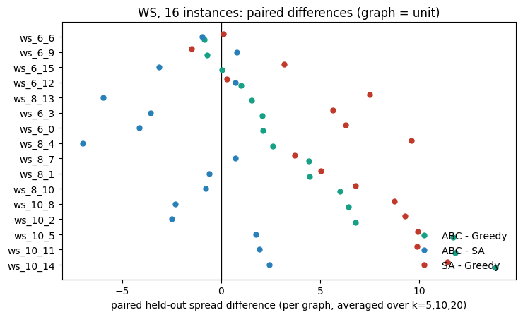
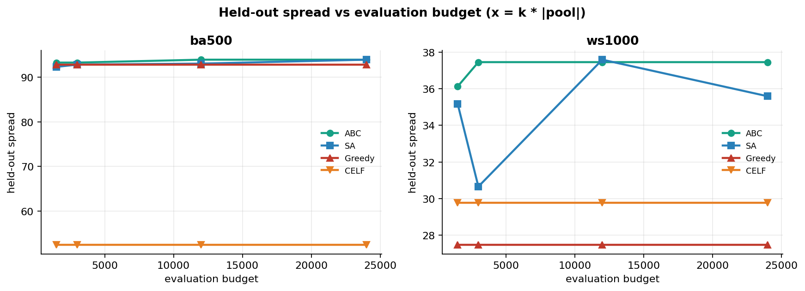

# Majority-Rule Influence Maximisation

## A plain-English report: what we tried, what worked, what failed, why, and what to try next

**Companion documents in this repository**

- `FINAL_FINDINGS.md` — the compact final technical summary.
- `MAJORITY_RULE_ABC_REPORT.md` — the full technical report with all tables.
- This document — the same project explained in simpler language, with the story, the intuition, the numbers, and the lessons.

**One-sentence summary.** We studied influence maximisation when a node activates only after a *majority* of its neighbours are active; we proved the model is monotone but **not** submodular, showed that this breaks the usual greedy/CELF guarantees in practice, built a discrete Artificial Bee Colony (ABC) optimiser, and found that set-level search clearly helps on sparse clustered graphs but that ABC is a budget-efficient, stable searcher rather than the best one — simulated annealing (SA) is at least as good.

---

# 1. The short version

## 1.1 The problem

We have a social network. We can choose **k seed nodes** and make them active at time zero. Influence then spreads from neighbour to neighbour according to a diffusion rule. The goal is to choose the k seeds that produce the largest final active set.

This is the classic **influence maximisation** problem. In the usual Linear Threshold (LT) model, the objective is submodular, greedy gives a (1 − 1/e) ≈ 63% guarantee, and CELF makes greedy fast. Our project asked what happens when the diffusion rule is a **majority rule** instead.

## 1.2 The seven findings that matter

1. **The majority-rule model is monotone.** Adding more seeds never reduces the expected spread. We proved this and checked it on 5,800 sampled seed pairs with zero violations.

2. **The majority-rule model is not submodular.** The “diminishing returns” property that greedy and CELF rely on is false. On a 3-leaf star, adding a node to an empty set gives +1, but adding the same node to a one-node set gives +3. The second copy of the node is worth *more*, not less. This is increasing returns — the opposite of submodularity.

3. **CELF breaks in practice, not just in theory.** Across the main-study plain CELF runs (not the hybrid), **50.24%** of lazy-bound re-checks violated the bound (418 out of 832). In a decision audit on 17 (graph, k) configurations, CELF picked a different set from exact Greedy in **16 of 17**, and scored strictly worse in **13 of 17**. On `ba500` with k = 30, CELF collapsed to about **131** held-out spread while Greedy was about **487**, Degree about **466**, and ABC about **484**.

4. **Set-level search beats marginal search on sparse clustered graphs.** On 16 independent Watts–Strogatz (WS) graphs of 1,000 nodes, ABC beat Greedy by **+4.57** held-out nodes on average, winning **14 of 16** graphs (bootstrap CI **[+2.46, +6.91]**, Wilcoxon **p = 3.1 × 10⁻⁴**). This is the pre-specified primary comparison and it passes the Bonferroni threshold.

5. **But SA is at least as good as ABC.** On the same 16 WS graphs, SA averaged **26.0** versus ABC **24.6** and Greedy **20.0**; SA beat Greedy by **+5.99** (15/16, p = 1.5 × 10⁻⁴). ABC’s advantage over Greedy is real; ABC’s claim to be the best set-level searcher is not.

6. **ABC’s real strengths are budget efficiency and stability.** On `ws1000`, k = 15, ABC reached its ceiling of **37.45** at **1×** budget, while SA needed **4×** budget to reach the same **37.59**. ABC also has a ≥ CELF guarantee (it is CELF-seeded and elitist) and very low run-to-run variation (std 1.05 spread units, CV 1.7%). It is also cheaper in wall-clock: about **4.5 s** per configuration versus **10.7 s** for SA.

7. **The signed extension generalises the model but gives no special search advantage.** Negative edges can make the objective non-monotone: adding an enemy seed can *reduce* spread. That is an interesting model result. But the sign-ablation control shows the ABC-vs-Greedy advantage persists — and even grows — on the all-positive twin of the same topology. The advantage is the majority plateau, not the signs.

## 1.3 What worked, what failed, what was neutral

| Area | What we tried | Outcome | Short reason |
|---|---|---|---|
| Theory | Prove monotonicity | **Worked** | Lock-step induction; 5,800 pairs, 0 violations |
| Theory | Prove submodularity | **Failed (the claim is false)** | Majority CDF is S-shaped, not concave; explicit counterexample |
| Theory | Quantify submodularity ratio γ | **Worked** | γ_min ≈ 0.29–0.85 for majority; 0.96–0.99 for LT control |
| Baseline | Exact Greedy | **Works but expensive** | Re-evaluates every candidate every round |
| Baseline | CELF | **Breaks** | Lazy bound is invalid without submodularity; 50.24% violations on plain CELF |
| Baseline | Degree / PageRank / k-core | **Cheap but weak on WS** | No coalition awareness |
| Baseline | BFSBall / DenseCluster | **Weak** | Locality alone is not enough; search matters |
| Solver | ABC vs Greedy on WS | **Worked** | +4.57, 14/16, p = 3.1 × 10⁻⁴ |
| Solver | ABC vs CELF | **Worked** | +2.69, 16/16 on WS; +12.4, 8/8 on BA |
| Solver | ABC vs SA | **Failed to win** | SA ≥ ABC on WS and BA |
| Solver | ABC budget efficiency | **Worked** | Ceiling at 1× budget vs SA’s 4× |
| Solver | ABC stability | **Worked** | Std 1.05, CV 1.7% |
| Operator | gbest guide | **Worked** | Only ablation that significantly hurts when removed (−0.132, p = 0.0006) |
| Operator | Refinement reserve | **Failed** | Removing it improves by +0.116 (p = 0.012); it starves the population search |
| Operator | Φ as fitness | **Failed** | BA 51.9 vs 57.5; Greedy+Φ worse on WS (23.6 vs 27.2) |
| Operator | Φ as tie-break | **Neutral** | No measurable gain |
| Operator | Metropolis acceptance | **Not default** | +2.5 on one config but still below SA |
| Explanation | δ-sweep “advantage tracks non-submodularity” | **Failed** | Confounded; partial correlations null |
| Extension | Signed graphs | **Model works; search advantage not sign-specific** | All-positive twin shows same or larger gain |
| Bound | Sandwich upper bound | **Valid but too loose** | α ≈ 13 on ba500 (k = 10); in a separate ws1000 k = 15 run the OPT bound is ≤ 1495 where the true optimum ≈ 38 |

## 1.4 The honest headline

The project is not “ABC beats everything”. The defensible story is:

> The majority-rule model is monotone but not submodular. That invalidates the textbook greedy/CELF guarantee, and CELF really does break. On sparse clustered graphs, searching whole seed sets beats building them one node at a time. ABC is a valid, cheap, stable member of the set-level search family, with a ≥ CELF guarantee — but SA is at least as good, so ABC should be presented as budget-efficient, not best-in-class.

That is a stronger and more honest contribution than a “new algorithm wins” claim, because every part of it is supported by theory, a counterexample, an audit, and a held-out equal-budget experiment.

---

# 2. The model, explained from scratch

## 2.1 Influence maximisation in one paragraph

A network is a graph: nodes are people, edges are friendships. We choose a small set S of **seeds** and turn them on. Influence then spreads. The **spread** σ(S) is the expected number of nodes that end up active. We want the S of size k that maximises σ(S).

The hard part is that influence is **not additive**. Two seeds can be redundant, or they can complement each other. The value of a seed depends on which other seeds are already chosen. That is why the problem is combinatorial and why the shape of σ matters so much.

## 2.2 The majority-rule diffusion model

The model in this repository is a **progressive threshold model**:

- Each node v has a **threshold** θ_v between 0 and 1.
- The threshold is drawn once and then **frozen**.
- A node becomes active when the fraction of its neighbours who are active is **strictly greater** than θ_v.
- Once active, a node stays active forever (“progressive”).

In symbols:

```
v activates  iff  |{active neighbours of v}|  >  θ_v · deg(v)
```

Because the rule uses a strict inequality, a node with degree d needs at least

```
need(v) = floor(θ_v · d) + 1
```

active neighbours. For a deterministic majority with θ = ½, a node of degree 3 needs 2 active neighbours; a node of degree 4 also needs 3 (exactly half is not enough).

This is a *local* majority: each node looks only at its own neighbourhood, not at the whole graph.

## 2.3 The four variants

| Variant | Threshold distribution | What it means |
|---|---|---|
| `dmr` | θ = ½ always | Deterministic strict majority |
| `smr` | θ ~ Uniform[½ − δ, ½ + δ] | Stochastic majority; δ = 0.15 is the workhorse |
| `lt` | θ ~ Uniform[0, 1] | Linear Threshold (Kempe et al. 2003); the submodular control |
| `slt` | θ ~ Uniform[0, ½ + δ] | Sandwich upper-bound model; used only for theory |

The important contrast is `smr` versus `lt`. In LT, a node’s activation probability rises linearly with the fraction of active neighbours. In majority, it stays near zero until the fraction gets close to ½, then rises sharply. That S-shaped curve is the source of all the trouble.

## 2.4 A tiny example: the 3-leaf star

Take a centre node w with three leaves x, y, z. Under deterministic majority, w needs 2 active neighbours.

- Start with S = ∅. Add y. Only y is active, so the spread is 1. The gain of y is **1**.
- Start with T = {x}. The spread is 1 (only x). Add y. Now x and y are both active, so w flips. Once w is active, z flips too. The final active set is {x, y, w, z}, size 4. The gain of y is **3**.

So:

```
gain(∅, y) = 1
gain({x}, y) = 3
```

The same node y is worth *more* when added to a larger set. That is **increasing returns**, and it violates submodularity. y is a **swing voter**: useless alone, decisive inside the winning coalition.

This tiny example is the whole story in miniature. A majority rule rewards the last vote that crosses the line and gives almost nothing to the votes before it. Greedy, which looks at one node at a time, cannot see that.

## 2.5 Monte Carlo, common random numbers, and held-out scoring

σ(S) is an expectation over random thresholds. We estimate it by simulation:

1. Draw R threshold vectors (each vector gives every node a threshold).
2. For each vector, run the cascade from S and count the final active set.
3. Average the counts over the R vectors.

Two details matter:

- **Common random numbers.** During optimisation, every candidate set is scored on the *same* R threshold vectors. This removes sampling noise from comparisons. If we used fresh randomness for every candidate, a lucky draw could make a bad set look good.
- **Held-out scoring.** After a solver returns its final seed set, we re-score it on *fresh* threshold vectors (R = 1000) that were never used during optimisation. This prevents “overfitting the thresholds”. The in-sample value is what the solver optimised; the held-out value is the honest estimate.

The mean in-sample minus held-out gap for ABC was **+0.13** (worst +4.4), so overfitting is not driving the conclusions.

## 2.6 Why absolute numbers matter

A 100% improvement over a tiny baseline can still be a tiny effect. We therefore report:

- **Absolute held-out spread** (number of active nodes).
- **Activation fraction** = spread / n.
- **Cascade fraction** = fraction of held-out draws in which the cascade exceeds k + 10 (a stricter “did it really take off?” measure).

On the main study, ABC, SA, and Greedy differ by less than 1% of n in activation fraction (0.2080, 0.2087, 0.2061). The WS wins are real but localised: the WS16 mean gain is **+4.57 nodes**, with per-graph means ranging from **−0.84 to +13.83** on n = 1,000. We should not describe them as “massive”.

---

# 3. The core theory: monotonicity and submodularity

This section explains the two words that drive the whole project. They sound similar but mean very different things.

## 3.1 Monotonicity: more seeds never hurt

**Claim.** If S ⊆ T, then σ(S) ≤ σ(T).

**Why it is true.** Fix one threshold vector. Run the cascade from S and from T side by side. At time zero, S ⊆ T. Suppose at some time step the active set from S is contained in the active set from T. If a node v activates under S, then more than θ_v · deg(v) of its neighbours are active under S. Since the S-active set is contained in the T-active set, the same inequality holds under T, so v activates under T too. By induction, the containment holds forever. Therefore the final active set from S is no larger than the final active set from T, for every threshold vector. Taking expectations preserves the inequality.

**Check.** We sampled 5,800 pairs (600 for karate, 600 for lesmis, 250 for ba500, for each of 4 variants) and found **0 violations**.

Monotonicity is useful: it says adding seeds is never harmful in the unsigned model. But it does **not** say the returns diminish.

## 3.2 Submodularity: diminishing returns

A set function f is **submodular** if adding an element to a larger set gives no more gain than adding it to a smaller set:

```
f(S ∪ {v}) − f(S)  ≥  f(T ∪ {v}) − f(T)     whenever S ⊆ T and v ∉ T
```

In words: the first few elements give a lot; later elements give less. This is “diminishing returns”.

Submodularity is the property that makes greedy work. If f is monotone and submodular, greedy achieves at least **(1 − 1/e) ≈ 63.2%** of the optimal value. That is the famous Nemhauser–Wolsey–Fisher guarantee.

## 3.3 Why greedy has a guarantee

Greedy builds the seed set one node at a time. At each step it evaluates every candidate and picks the one with the largest marginal gain. Under submodularity, the gain of the best single node is at least 1/k of the remaining gap to the optimum, so after k steps you are within 63% of optimal. The proof is short but the intuition is enough: diminishing returns prevent greedy from making a catastrophic early choice, because anything that looks good early cannot become much better later.

## 3.4 CELF: lazy greedy

CELF (“Cost-Effective Lazy Forward”) speeds up greedy. It stores each candidate’s last marginal gain and uses a priority queue. The key assumption is:

> A stale marginal gain is an **upper bound** on the current marginal gain.

If that is true, CELF can skip a candidate whose stale gain is already below the best fresh gain, because it cannot possibly win. Under submodularity, the assumption is true. Under a majority rule, it is false: a candidate that looked bad early can become much better later, because of increasing returns. CELF then skips the wrong candidates and can return a worse set than exact Greedy.

## 3.5 Why majority breaks submodularity

The 3-leaf star already shows it:

```
gain(∅, y) = 1
gain({x}, y) = 3
```

The marginal gain *increases* as the set grows. This is the opposite of diminishing returns.

The deeper reason is the shape of the threshold CDF. Let F_v(a) be the probability that a node with degree d activates when a of its neighbours are active. For a majority rule, F_v is an **S-curve**: flat near zero, steep near ½, flat near one. The steep middle is **convex**, not concave. Mossel and Roch (2007) proved that if every local activation function is submodular — equivalently, if the threshold CDF is concave — then the global spread is submodular. That condition is **sufficient**, not necessary. A majority rule fails it, and the star shows that the actual function really does violate submodularity.

For LT, F_v(a) = a/d, which is linear. Linear is both concave and convex, so LT passes the sufficient condition and is submodular. That is why LT is the clean control: 0.0% violations in our scans.

## 3.6 How badly does it fail?

We enumerated every triple (S ⊆ T, v ∉ T) with |T| ≤ 3 on a capped, degree-stratified node set, with a Monte-Carlo noise tolerance. The results:

| Graph | Variant | Non-degenerate violation rate | γ_min |
|---|---|---:|---:|
| karate | LT control | **0.0%** | 0.992 |
| karate | smr δ = 0.30 | 66.3% | 0.511 |
| karate | smr δ = 0.15 | 68.7% | 0.345 |
| karate | dmr | 52.6% | 0.292 |
| lesmis | LT control | **0.0%** | 0.967 |
| lesmis | smr δ = 0.30 | 64.4% | 0.462 |
| lesmis | smr δ = 0.15 | 60.4% | 0.653 |
| lesmis | dmr | 47.0% | 0.333 |
| ba500 | LT control | **0.0%** | 0.963 |
| ba500 | smr δ = 0.30 | 59.1% | 0.845 |
| ba500 | smr δ = 0.15 | 75.7% | 0.693 |
| ba500 | dmr | 70.4% | 0.667 |

“Non-degenerate” means at least one of the two gains actually involved a cascade; otherwise the triple is a trivial tie (both gains = 1) and dilutes the statistic. The contrast is stark: every majority variant shows 47–76% violations, while LT shows exactly 0.0%.

The **submodularity ratio** γ is a number between 0 and 1 that measures how close a function is to being submodular. γ = 1 means submodular; smaller γ means worse diminishing returns. For majority we measured γ_min ≈ **0.29–0.85**; for LT, **0.96–0.99**. The greedy guarantee becomes (1 − e^(−γ)), which is weaker than 63% when γ is small. This is the honest replacement for the textbook bound.

## 3.7 What is still true, and what is not

- **True:** monotonicity.
- **False:** submodularity for any genuine majority rule.
- **True:** the Mossel–Roch condition is sufficient, not necessary; failing it does not by itself prove non-submodularity, which is why we also produced explicit counterexamples and exhaustive scans.
- **Not automatically true:** the Lu et al. hardness result for general deterministic thresholds does not transfer to our uniform-½ special case. We therefore measure approximation quality empirically against brute-force optima on small graphs instead of claiming a hardness result.
- **Useful but weak:** the submodularity ratio γ gives a guarantee, but it is instance-specific and optimistic because γ_min is estimated from samples.

## 3.8 The sandwich bound: a valid upper bound that is too loose

There is a clever theoretical trick. The concave envelope of the majority CDF is

```
F̄(x) = min(x / (½ + δ), 1)
```

which is exactly an LT-type model with θ ~ Uniform[0, ½ + δ] (the `slt` variant). Because F̄ ≥ F pointwise, a common-uniform coupling gives σ̄(S) ≥ σ(S) for every S. And because F̄ is concave, σ̄ is submodular, so CELF is valid on σ̄.

This gives:

- an upper bound OPT ≤ σ̄(S) · e/(e − 1), and
- an after-the-fact guarantee σ(S) ≥ (1 − 1/e) · OPT / α(S), where α(S) = σ̄(S)/σ(S).

The problem is that α is huge. On `ba500` at k = 10, α ≈ **13** (across `ba500`’s tested k, it ranges from about 3.7 to 61.7). The bound is technically true but practically vacuous. In a separate `ws1000` k = 15 run, the upper bound was ≤ **1495** where the true optimum is around **38**. Sandwich-CELF is therefore the weakest budgeted seeder (activation fraction 0.163). We kept it as a theory layer, not as a competitive method.

---

# 4. What we built

## 4.1 Code map

| File | What it does |
|---|---|
| `majority_rule_model.py` | The diffusion model, GPU/CPU cascade simulator, candidate pool, baseline heuristics, exact Greedy, Greedy+Φ, CELF, BFSBall, DenseCluster, held-out model |
| `signed_rule_model.py` | Signed/weighted extension, signed graph generators, non-monotonicity witness search |
| `theory_checks.py` | Monotonicity checks, K₁,₃ counterexample, δ-sweep on stars, exhaustive submodularity scans, Mossel–Roch local curvature, submodularity ratio |
| `abc_celf.py` | Discrete ABC with all W1–W9 operators, CELF seeding, local exchange refinement, 2-swap shaking |
| `baselines.py` | Simulated annealing (SA), GRASP, Sandwich-CELF |
| `run_experiments.py` | Main studies S1–S11, figures, summary JSON |
| `run_validation.py` | Brute-force OPT, leave-one-out ablation, CELF decision audit, signed validation |
| `extend_ws.py` | Extends the WS family from 8 to 16 instances for the primary comparison |

The code is written to be resumable: long studies append each result row to a CSV and skip already-completed cells on re-run. The GPU backend uses PyTorch sparse matrix products (RTX 3060 in our runs) and falls back to CPU automatically.

## 4.2 Experiment map

| Stage | Purpose |
|---|---|
| S1 | Structural verification: monotonicity, non-submodularity, Mossel–Roch, γ |
| S2 | Exact optimum by brute force on small graphs, held-out corrected |
| S3 | Main comparison: all algorithms × 10 graphs × k ∈ {5, 10, 20, 30} |
| S4 | Convergence curves: best-so-far vs evaluations spent |
| S5 | δ-sweep from deterministic majority to LT, with structural measurements |
| S8 | Signed graphs, same protocol |
| S9 | Budget scaling: 0.5×, 1×, 4×, 8× |
| S10 | Multi-instance family study: 16 WS, 8 BA, 8 SBM; graph is the unit |
| S11 | Sign-ablation control: signed graph vs all-positive twin |

## 4.3 The evaluation protocol (why the numbers are trustworthy)

This protocol was a major part of the work. Earlier drafts had weaker comparisons; the final protocol fixes them.

1. **Equal budget.** Greedy’s natural cost is exactly k × |pool| fresh cascade evaluations. Every budgeted solver — Greedy, Greedy+Φ, CELF+LS, Sandwich-CELF, SA, GRASP, ABC, ABC-CELF — is capped at that same number. CELF alone is kept as the cheap baseline. The budget audit found **0 violations across 532 rows** of the main study. Without equal budget, a method can “win” simply by evaluating more sets.

2. **Held-out scoring.** Every final seed set is re-scored on fresh, independent threshold draws with R = 1000. All comparisons use the held-out column. The in-sample value is reported separately. This prevents a solver from being rewarded for fitting the particular thresholds it optimised on.

3. **Graph as the statistical unit.** Spreads are averaged over k within a graph before any test. Then paired differences are compared across independent graphs. This avoids treating correlated (graph, k) configurations as independent evidence.

4. **Paired tests and confidence intervals.** We use Wilcoxon signed-rank tests across graphs and cluster-bootstrap confidence intervals that resample graphs, not configurations.

5. **Multiplicity control.** Nine family-by-comparison tests give a Bonferroni threshold of 0.0056. Exactly one comparison was pre-specified as primary: **ABC vs Greedy on WS (n = 16)**. All other comparisons are exploratory and reported as effect sizes with CIs.

6. **Model definition frozen for sign-off.** Progressive activation, strict inequality, `need = floor(θ · deg) + 1`, frozen thresholds, common random numbers within a model, independent draws across fit and score.

## 4.4 Graph families

- **WS (Watts–Strogatz):** 1,000 nodes, degree ∈ {6, 8, 10}, rewiring p = 0.1. Sparse, locally clustered, no huge hubs. This is where set-level search should matter most.
- **BA (Barabási–Albert):** 1,000 nodes, attachment m ∈ {3, 4, 5}. Hub-heavy. Greedy can pick hubs and cascades start easily.
- **SBM (stochastic block model):** 3 × 300 nodes, p_in ∈ {0.03, 0.04, 0.05}, p_out = 0.1 × p_in. Community structure.
- **Small graphs:** karate, lesmis, florentine, davis, star60, cycle60, grid100, tree63, barbell50, caveman60, windmill46. Used for exact OPT and tuning.
- **Tuning graphs:** 13 graphs disjoint from the test graphs, used for leave-one-out ablation.

---

# 5. What we tried

This section is the “lab notebook” view: every major idea, why we tried it, and what happened.

## 5.1 Theory checks

We started by trying to prove what the brief asked for: that the model is monotone and submodular.

- **Monotonicity** was provable. The lock-step induction is clean, and the empirical check found no violations.
- **Submodularity** was not provable because it is false. The 3-leaf star is a minimal counterexample. We then checked how robust the counterexample is under stochastic thresholds:
  - K₁,₃: violation clear for δ ≲ 0.3.
  - K₁,₉ with T = 4 leaves: still visible at δ = 0.35 (+0.40) and δ = 0.40 (+0.16), gone by δ = 0.45.
  - At δ = 0.5 (LT), the violation disappears — the positive control works.
- **Exhaustive scans** confirmed that this is not a one-off: 47–76% of non-degenerate triples violate diminishing returns on majority variants, versus 0.0% for LT.
- **Mossel–Roch** gave the structural explanation: the majority threshold CDF is not concave. This is a sufficient-condition failure, not a proof by itself, which is why the explicit counterexamples and scans matter.
- **Submodularity ratio γ** gave an honest quantitative replacement for the 1 − 1/e bound.

## 5.2 Baselines

We implemented several families of baselines so that the comparison is fair and informative.

**Zero-MC heuristics (no cascade simulation):**

- Random.
- Degree.
- PageRank.
- k-core.
- MajorityDiscount: a majority-aware degree discount that scores a node by how close it moves its neighbours to their thresholds, discounted by overlap with chosen seeds.
- BFSBall: grow a connected BFS ball from the highest-degree node.
- DenseCluster: iteratively add the node with the most already-chosen neighbours.

**Marginal-gain methods:**

- Greedy: exact greedy, re-evaluates every candidate every round.
- Greedy+Φ: greedy with the plateau potential Φ as a tie-breaker.
- CELF: lazy greedy.
- CELF+LS: CELF followed by 1-opt + 2-swap + cascade-aware refinement.

**Set-level methods:**

- SA: 1-swap neighbourhood, fitness = σ + λΦ, geometric cooling, reheat, frozen-state early stop.
- GRASP: greedy-randomised construction + first-improvement local search, restarted within budget.
- ABC (proposed): CELF-seeded, gbest-guided population search, no refinement.
- ABC (no refinement): the historical label for the same search without CELF seeding. Both the proposed ABC and this variant have no refinement phase; the difference is the seed, not refinement.
- ABC-CELF (hybrid): ABC plus periodic CELF-style refinement.
- Sandwich-CELF: CELF on the submodular upper-bound model σ̄, scored on σ.

## 5.3 The ABC design

Canonical ABC (Karaboga 2005; Karaboga & Basturk 2007) is a bee-inspired optimiser:

- **Food sources** are candidate solutions.
- **Employed bees** exploit known sources by making small changes.
- **Onlooker bees** choose good sources and exploit them further.
- **Scout bees** abandon exhausted sources and explore randomly.

For influence maximisation, a food source is a **seed set of size k**, and a “small change” is a **swap**: remove one seed, add another. The canonical algorithm has well-known weaknesses. We addressed each one with an operator from the ABC-improvement literature:

| # | Canonical weakness | Literature fix | What we did |
|---|---|---|---|
| W1 | Weak exploitation, slow late-stage convergence | Gbest-guided ABC (Zhu & Kwong 2010) | With probability 0.6, the partner is the global best set |
| W2 | Premature convergence of roulette-wheel selection | Tournament selection | Tournament size 4 |
| W3 | Blind random scout restarts | Directed scouts (Kiran & Fındık 2015) | Rebuild abandoned sources near the incumbent |
| W4 | Fixed perturbation strength | Modification rate (Akay & Karaboga 2012) | `n_mod` partner swaps + mutation per candidate |
| W5 | Duplicate food sources | — | Deduplicate |
| W6 | Refinement blows the budget | — | Refinement gets only the remaining budget; gating |
| W7 | Rigid moves on plateaus | — | Φ tie-break, accept-equal, random exploration moves |
| W8 | 1-opt cannot repair coalitions | — | Cascade-aware candidates + 2-swap shaking |
| W9 | Signed graphs: no operator can remove harmful seeds | — | Generic swaps handle it; sign-aware initialisation |

The **plateau potential** is

```
Φ(S) = Σ_v min(1, net_v / need_v)
```

evaluated at cascade close. Active nodes contribute 1; inactive nodes contribute how close they are to flipping. It is computed in the same cascade pass, so it costs no extra evaluations. The idea is to give the search a gradient on the flat plateau where σ is constant. Acceptance is **lexicographic**: σ must improve beyond a tolerance of 2 Monte-Carlo standard errors; within that noise band, Φ decides.

## 5.4 Configuration selection by leave-one-out ablation

We tuned on **13 graphs disjoint from the test graphs**, with **26 (graph, k) configurations** and **20 seeds** per configuration. We started from the full configuration and removed one operator at a time. The results:

| Removed operator | Δ mean held-out vs full | Wins | p |
|---|---:|---:|---:|
| −gbest | **−0.132** | 1/26 | **0.0006** |
| −tournament | +0.020 | 6/26 | 0.40 |
| −directed_scout | −0.013 | 6/26 | 0.68 |
| −dedupe | −0.006 | 5/26 | 0.25 |
| −accept_equal | −0.001 | 1/26 | 0.99 |
| −explore | +0.041 | 7/26 | 0.76 |
| −potential (Φ) | +0.004 | 8/26 | 0.75 |
| −reserve (refinement budget) | **+0.116** | 11/26 | **0.012** |
| −two_swap | −0.015 | 1/26 | 0.19 |
| −cascade_aware | 0.000 | 0/26 | 1.0 |

Two conclusions:

1. **The gbest guide is the only operator whose removal significantly hurts.** It gives the search direction; without it, ABC is much weaker.
2. **The refinement budget reservation hurts.** Removing it improves by +0.116. The refinement phase takes budget away from the population search and does not pay it back at equal budget. So the final method has **no refinement phase**.

The effects are small (under 1% of spread) and the effective sample is about 13 graphs, so this table is for selecting a minimal configuration, not for claiming large component effects.

**Final configurations:**

- **ABC (proposed):** CELF-seeded, gbest-guided population search, tournament selection, directed scouts, dedupe, accept-equal, Φ tie-break, explore probability 0.15, **no refinement**. Elitism + CELF seeding means it never returns worse than CELF.
- **ABC-CELF (hybrid):** the above plus periodic CELF-style refinement. Kept as an ablation, not the default. At equal budget it is essentially a wash overall (mean **+0.01** spread units across the 114 paired main-study runs; it is slightly better on WS but worse on BA and `powerlaw1000`). The reason to drop the refinement is the LOO ablation: removing the refinement budget reservation improves mean held-out spread by **+0.116** (11/26 wins, p = 0.012), so the reserve costs more than the refinement returns.
- **Metropolis variant:** tested, +2.5 on `ws1000` k = 30 (66.7 vs 64.3), but still below SA (73.7). Kept as a config flag, not the default.

## 5.5 The signed extension

We generalised the model to signed, weighted edges:

```
v activates iff  (positive active weight − negative active weight) > θ_v · deg(v)
```

For an all-positive graph this reduces exactly to the unsigned model. Negative edges break **monotonicity**: adding an enemy seed can lower a node’s net support and push it back below threshold.

We found:

- A **constructive witness**: a hub with 4 positive leaves, a positive follower, and one enemy leaf. Seeding {1,2,3,4} gives spread 6; seeding {1,2,3,4,5} gives spread 5. A larger seed set has smaller influence.
- A **located witness** on a random signed BA graph (200 nodes, 20% negative edges): σ(S) = 48.67, σ(S ∪ {v}) = 48.42, a drop of 0.26 (above the 4-SE tolerance). Random sampling almost never finds these (1/400 on the hub example, 0/2000 elsewhere), so we used a structured search: S = positive neighbourhood of a node just below its threshold, v = one of its enemies.

The signed model is interesting because greedy/CELF assume monotonicity and submodularity, and both fail. ABC’s swap operators can remove harmful seeds, which greedy cannot express. But the sign-ablation control showed that the *search* advantage is not specific to signs.

## 5.6 Budget, regime, and negative controls

We also ran:

- **Budget scaling** on `ba500` and `ws1000` at 0.5×, 1×, 4×, 8× the base budget.
- **Regime analysis**: define k* as the smallest tested k at which Greedy’s final set first triggers any cascade, then compare gains below and above k*.
- **Random-percolation control**: random k-sets instead of optimised sets, to see whether cascades happen without search.
- **δ-sweep**: move from deterministic majority (δ = 0) to LT (δ = 0.5) and correlate the ABC advantage with structural measures.
- **Sign-ablation control**: same topology, all-positive twin.

## 5.7 Summary table of attempts

| Attempt | Why we tried it | Result |
|---|---|---|
| Prove submodularity | The brief asked for it | False; counterexample + scans |
| Prove monotonicity | The brief asked for it | True; proof + 5,800 checks |
| Use exact Greedy | Classic baseline | Works but expensive |
| Use CELF | Fast greedy | Breaks; 50.24% lazy violations on plain CELF |
| Use degree/PageRank/k-core | Cheap baselines | Weak on WS; okay on BA |
| Use BFSBall/DenseCluster | Test whether locality is enough | Not enough; search matters |
| Use SA | Strong set-level baseline | At least as good as ABC |
| Use GRASP | Another set-level baseline | Mid-pack |
| Use ABC | Main proposed method | Beats Greedy on WS; below SA |
| Add gbest guide | Improve exploitation | Works; only significant operator |
| Add refinement | Polish coalitions | Hurts at equal budget |
| Add Φ as fitness | Smooth the plateau | Hurts |
| Add Φ as tie-break | Use plateau information gently | Neutral |
| Add Metropolis | Escape local optima | Helps one config, still below SA |
| Use sandwich bound | Valid submodular upper bound | Too loose to be useful |
| Extend to signed graphs | Richer model | Model works; no sign-specific search advantage |
| δ-sweep explanation | Link advantage to non-submodularity | Confounded; withdrawn |
| Random percolation | Independent definition of k* | Random sets never cascade for k ≤ 20 |

---

# 6. Results

This section gives the numbers. The headline is in §6.4; the rest explains the supporting evidence and the negative results.

## 6.1 Theory results

### Monotonicity

- 5,800 sampled pairs across 12 graph × variant configurations.
- **0 violations.**
- Worst gap: 0.

### The minimal counterexample

On K₁,₃ under deterministic majority:

| Coalition | Gain of adding y |
|---|---:|
| S = ∅ | **1.0** |
| T = {x} | **3.0** |

This is increasing returns. The violation is +2.0.

### Does softening the threshold rescue submodularity?

| δ | Variant | gain(S, y) | gain(T, y) | Submodular? |
|---:|---|---:|---:|---|
| 0.00 | dmr | 1.00 | 3.00 | No (+2.00) |
| 0.05 | smr | 1.00 | 3.00 | No |
| 0.10 | smr | 1.00 | 3.00 | No |
| 0.20 | smr | 1.25 | 2.58 | No (+1.33) |
| 0.30 | smr | 1.65 | 1.90 | No (+0.25) |
| 0.50 | lt | 1.98 | 1.35 | **Yes** (control) |

For a larger star K₁,₉ with T = 4 leaves, the violation survives to δ = 0.35 (+0.40) and δ = 0.40 (+0.16), and disappears by δ = 0.45. So “majority breaks submodularity” is not just a deterministic curiosity; it survives realistic threshold noise.

### Exhaustive scans

The table in §3.6 is the key result. Every majority variant has a large non-degenerate violation rate; LT has exactly 0.0%. The submodularity ratio γ_min is 0.29–0.85 for majority and 0.96–0.99 for LT.

### Sandwich bound

- α ≈ 13 on `ba500` at k = 10 (about 3.7–61.7 across `ba500`’s tested k).
- In a separate `ws1000` k = 15 run, the OPT upper bound is ≤ 1495 where the true optimum is around 38.
- Sandwich-CELF activation fraction 0.163 — the weakest budgeted seeder.

## 6.2 CELF breaks — the audit

This is one of the most important empirical results.

**Lazy-bound violations across the main-study plain CELF runs:** 418 violations / 832 re-checks = **50.24%**. This denominator is the CELF algorithm itself in the main study; the ABC-CELF hybrid has separate counters and is not included.

**Decision audit** on 17 (graph, k) configurations:

- CELF’s chosen set differs from exact Greedy’s in **16 of 17**.
- CELF scores strictly below Greedy in **13 of 17**.
- Of those 13, three are within 1% of Greedy (`karate` k = 10, 0.08%; `lesmis` k = 20, 0.05%; `sbm900` k = 10, 0.92%). One further differing case (`sbm900` k = 5) has identical held-out spread but a different set. The remaining gaps are larger.
- CELF is sometimes *better* than Greedy (for example `ws1000`, k = 10: CELF 17.1 vs Greedy 10.5). That is exactly the point: without submodularity, CELF is **unreliable in both directions**, not uniformly bad.

The most dramatic collapse is `ba500`, k = 30 (held-out):

| Method | Held-out spread |
|---|---:|
| CELF | ≈ 131 |
| Greedy | ≈ 487 |
| Degree | ≈ 466 |
| ABC | ≈ 484 |

CELF loses to a trivial degree ranking. This is not a “metaheuristic miracle”; it is CELF’s lazy bound failing on a hub-heavy graph.

**Why this matters.** Under submodularity, CELF would reproduce exact Greedy exactly. The fact that it differs in 16/17 and is worse in 13/17 is direct decision-relevant evidence that the lazy bound is not valid here.

## 6.3 Exact optima on small graphs

We brute-forced all k-subsets on six small graphs. The OPT set itself was re-scored on held-out draws, so the ratio is held-out spread / held-out OPT. A ratio slightly above 1.0 is possible because of held-out noise.

| Graph (k) | Degree | Greedy | CELF | CELF+LS | ABC |
|---|---:|---:|---:|---:|---:|
| karate (4) | 0.955 | 0.977 | 0.917 | **1.000** | **1.003** |
| lesmis (3) | 0.744 | **1.000** | 0.872 | 0.884 | **1.000** |
| florentine (4) | 0.937 | **1.000** | 0.833 | 0.937 | **1.000** |
| davis (3) | 0.950 | **1.000** | 0.741 | 0.760 | 0.977 |
| star60 (3) | 1.000 | 1.000 | 1.000 | 1.000 | 1.000 |
| cycle60 (3) | 0.535 | **1.000** | 1.000 | 1.000 | **1.000** |

Reading this table:

- ABC is at or slightly above the held-out optimum on **5 of 6** graphs (karate 1.003, lesmis/florentine/star/cycle 1.000); davis is 0.977. If you count only exact 1.000 values, ABC has 4 of 6.
- Greedy is at the optimum on 5 of 6 (all except karate).
- CELF is at the optimum only on star60 and cycle60; on the non-trivial graphs it is 0.74–0.92.
- CELF+LS repairs karate to OPT (the 2-swap phase fixes the coalition that 1-opt cannot), but not the other non-trivial graphs at equal budget.

On `grid100`, a pathological plateau case, the whole family saturates at about **81%** of OPT at equal budget; ABC reaches **97%** with a 17× budget. This is a useful warning: even set-level search can be trapped when the plateau is very flat.

## 6.4 Primary result: 16 fresh WS instances

This is the pre-specified primary comparison. Each graph is Watts–Strogatz(1000), degree ∈ {6, 8, 10}, p = 0.1, fresh seeds. Spreads are averaged over k ∈ {5, 10, 20} within each graph, then compared across the 16 graphs.

| Comparison | Mean difference (held-out) | Wins | Wilcoxon p | Bootstrap CI |
|---|---:|---:|---:|---|
| **ABC − Greedy (primary)** | **+4.57** | **14/16** | **3.1 × 10⁻⁴** | **[+2.46, +6.91]** |
| SA − Greedy | +5.99 | 15/16 | 1.5 × 10⁻⁴ | [+4.01, +7.85] |
| ABC − SA | −1.41 | 6/16 | 0.093 | [−2.84, −0.12] |
| ABC − CELF | +2.69 | 16/16 | 3.1 × 10⁻⁵ | [+1.83, +3.89] |

Family means (held-out spread, averaged over graphs and k):

| Method | Mean |
|---|---:|
| SA | 26.0 |
| ABC | 24.6 |
| CELF+LS | 24.1 |
| CELF | 21.9 |
| Greedy | 20.0 |
| BFSBall | 13.6 |
| DenseCluster | 12.9 |

The primary comparison passes the Bonferroni threshold of 0.0056. The other comparisons are exploratory.

**Cascade fraction** — the share of the 1,000 held-out draws in which the cascade exceeds k + 10:

| Method | ≥ k + 10 | ≥ k + 5 |
|---|---:|---:|
| ABC | **0.542** | 0.696 |
| SA | 0.509 | 0.680 |
| CELF | 0.428 | 0.614 |
| Greedy | **0.330** | 0.484 |

This is a stronger “did the cascade really take off?” measure than spread > k, which a tiny excess could satisfy. ABC produces a real cascade in about 54% of draws versus Greedy’s 33%.

**Per-graph ABC − Greedy differences:** +13.8, +11.8, +11.7, +6.8, +6.4, +6.0, +4.5, +4.4, +2.6, +2.1, +2.0, +1.5, +1.0, +0.03, −0.7, −0.8. Positive on 14 of 16. The two losses are small; the wins can be large.



## 6.5 BA and SBM: where the advantage disappears or weakens

### BA (8 instances)

| Comparison | Mean difference | Wins | p | CI |
|---|---:|---:|---:|---|
| ABC − Greedy | +0.26 | 5/8 | 0.64 | [−0.42, +1.06] |
| ABC − SA | −0.49 | 2/8 | 0.039 | [−0.79, −0.18] |
| ABC − CELF | +12.4 | 8/8 | 0.0078 | — |

Means: SA 40.6, ABC 40.1, Greedy 39.8, CELF+LS 30.3, CELF 27.7.

This is a **wash** against Greedy. Hub-heavy graphs are easy for greedy: the hubs are obvious, and a cascade starts even with a small seed set. There is no plateau to exploit. SA is slightly but significantly better than ABC.

### SBM (8 instances)

| Comparison | Mean difference | Wins | p | CI |
|---|---:|---:|---:|---|
| ABC − Greedy | +0.58 | 6/8 | 0.078 | [+0.07, +1.14] |
| ABC − SA | −0.05 | 4/8 | 0.84 | [−0.34, +0.20] |
| ABC − CELF | +1.57 | 8/8 | 0.0078 | — |

Means: SA 13.69, ABC 13.64, Greedy 13.06, CELF 12.08.

This is **suggestive**, not conclusive: the CI excludes zero, but p = 0.078 at n = 8. The effect is in the same direction as WS but weaker.

## 6.6 Locality is not enough

A natural hypothesis is that majority cascades need a connected, dense coalition, so a BFS ball or a dense cluster should do well. The results say no:

- On WS, SA beats BFSBall by **+13.1** (8/8, p = 0.0078, CI [+12.1, +14.1]).
- On BA, SA beats BFSBall by **+17.6** (8/8).
- On SBM, SA beats BFSBall by **+2.0** (8/8).

Dense connected coalitions are **necessary but not sufficient**. What matters is *search*: trying many coalitions and keeping the ones that actually cascade. BFSBall and DenseCluster pick one coalition and never evaluate alternatives.

## 6.7 Regime: the contagion-threshold window

Define **k\*** as the smallest tested k at which Greedy’s final set first triggers any cascade (held-out spread > k).

- On WS, the ABC advantage is concentrated **below k\***: mean relative gain **+65%** below k\* versus **+23%** at or above.
- The WS16 mean gain is **+4.57 nodes**. Per-graph means range from **−0.84 to +13.83**, and regime-bucket means range from **+2.2 to +8.4 nodes**, peaking at k\* − 10.
- At k\* + 15, the advantage shrinks to about **+7%**.
- On BA, Greedy already cascades at k = 5 because of hubs, so there is no window and no advantage.
- On SBM, the same pattern appears but weaker: **+17%** below k\* versus **+3%** at or above.

**Circularity caveat.** Defining k\* from Greedy makes this a description of *Greedy’s blindness*, not an independent mechanism. We tried to define k\* independently by random percolation, but **random k-sets never cascade for k ≤ 20** on any instance. That failure is itself the phenomenon: majority cascades require *chosen* coalitions. Random seeds are too dispersed to push any node over its threshold.

## 6.8 Budget and wall-clock

On `ws1000`, k = 15:

| Budget multiplier | Greedy | CELF | ABC | SA |
|---:|---:|---:|---:|---:|
| 0.5× | 27.49 | 29.79 | **36.13** | 35.17 |
| 1× | 27.49 | 29.79 | **37.45** | 30.66 |
| 4× | 27.49 | 29.79 | 37.45 | **37.59** |
| 8× | 27.49 | 29.79 | 37.45 | 35.59 |

On `ba500`, k = 15:

| Budget multiplier | Greedy | CELF | ABC | SA |
|---:|---:|---:|---:|---:|
| 0.5× | 92.85 | 52.48 | 93.30 | 92.34 |
| 1× | 92.85 | 52.48 | 93.30 | 92.85 |
| 4× | 92.85 | 52.48 | 93.95 | 93.07 |
| 8× | 92.85 | 52.48 | 93.95 | 93.95 |

Interpretation:

- **ABC reaches its ceiling at 1× budget** on `ws1000` and stays flat through 8×. It spends the full budget (24,000/24,000 evaluations), so the flatness is a plateau, not early stopping.
- **SA needs 4× budget** to reach the same ceiling (37.59 vs 37.45).
- A 16× multi-start SA run gets 38.72, so there is no big escape.
- On `ba500`, Greedy is already near-optimal at 0.5× (92.85), which is consistent with the BA wash.
- The sandwich bound is vacuous at this scale, so near-optimality is supported only by budget-insensitivity: 32× more budget buys less than 1 spread unit.

**Wall-clock per configuration:**

| Solver | Time (s) |
|---|---:|
| CELF | 0.18 |
| CELF+LS | 0.74 |
| ABC | 4.5 |
| Greedy | 5.96 |
| GRASP | 6.04 |
| ABC-CELF (hybrid) | 7.14 |
| Sandwich-CELF | 7.92 |
| SA | 10.71 |

ABC is the cheapest of the set-level methods. SA’s extra time is genuine search, not overhead: 2.5 ms/evaluation vs ABC’s 1.9 ms/evaluation. **At equal wall-clock**, ABC at about 2.4× budget stays at 37.5 while SA at 1× reaches only 30.7, so ABC wins the equal-time comparison. At equal budget, SA ≥ ABC.

ABC run-to-run stability: within-config standard deviation **1.05** spread units, coefficient of variation **1.7%**.



## 6.9 Ablation: which ABC operators matter

The leave-one-out table in §5.4 is the result. In plain words:

- **gbest guide:** essential. Remove it and ABC drops by 0.132 on average, winning only 1 of 26 configs. p = 0.0006.
- **refinement reserve:** harmful. Remove it and ABC improves by 0.116. p = 0.012.
- **everything else:** neutral at this budget. Effects are under 1% and not significant. This is an honest negative result: many literature-inspired operators did not earn their place. The final configuration is minimal.

## 6.10 Signed graphs

Family means (held-out spread):

| Method | Mean |
|---|---:|
| SA | 17.72 |
| ABC | 17.55 |
| Greedy | 15.42 |
| CELF+LS | 15.07 |
| CELF | 14.64 |
| NetSupport | 11.81 |

Per-configuration highlights:

| Graph | k | Greedy | CELF | SA | ABC |
|---|---:|---:|---:|---:|---:|
| signed_sbm120 | 15 | 20.4 | 18.2 | **44.0** | 40.6 |
| signed_ws300 | 15 | 21.7 | 22.2 | 26.6 | **27.2** |
| signed_ba500 | 15 | 28.0 | 22.0 | **29.3** | 28.8 |
| signed_cycle40 | 15 | 30.9 | 30.9 | 31.0 | 30.9 |

Where cascades exist (`signed_sbm120`, k = 15), set-level search is about 2× Greedy. On the signed BA graph it is a near-tie. `signed_sbm450` activates nothing at k ≤ 15 — a trivial regime reported as such.

**Sign-ablation control** — same topology, all-positive twin:

| Graph | k | Edges | Greedy | ABC | ABC vs Greedy |
|---|---:|---|---:|---:|---:|
| sbm120 | 15 | signed | 19.9 | 38.9 | +95% (+19.0 nodes) |
| sbm120 | 15 | positive twin | 19.8 | 55.6 | **+181% (+35.8 nodes)** |
| ws300 | 15 | signed | 21.0 | 26.9 | +27.6% (+5.8) |
| ws300 | 15 | positive twin | 36.8 | 40.7 | +10.8% (+4.0) |

The ABC-vs-Greedy advantage **persists and even grows** when the signs are removed. So the advantage is the plateau effect, not the sign structure. Negative edges do shrink everyone’s absolute spread, but that is a model property, not a search effect.

## 6.11 The δ-sweep and why we withdrew the explanation

We swept δ from 0 (deterministic majority) to 0.5 (LT) on `ba500` and `ws1000`, measuring the ABC-vs-Greedy and ABC-vs-CELF gains alongside the violation rate and γ.

On `ba500`, the ABC-vs-CELF gap shrinks monotonically with δ (Spearman ρ = −0.976, p = 3 × 10⁻⁵), but the ABC-vs-Greedy gap is a wash at every δ. On `ws1000`, the ABC-vs-Greedy advantage is large for δ ≤ 0.2 and gone beyond.

The tempting story was “the advantage tracks the loss of submodularity”. But δ changes **both** the structural measures and the cascade size, so raw correlations are near-automatic. When we controlled for δ with partial correlation, every association vanished:

- `ba500` vs Greedy: ρ_partial = +0.42, p = 0.31.
- `ba500` vs CELF: ρ_partial = +0.13, p = 0.75.
- `ws1000` vs Greedy: ρ_partial = +0.03, p = 0.95.

A fixed-δ test across the 24 multi-instances also found no reliable correlation between the violation rate and the ABC-vs-Greedy gain: ρ = −0.23, p = 0.28.

So the δ-sweep claim is **withdrawn**. The structural claims rest on the proof, the counterexample, the scans, and the CELF audit — not on the sweep. The advantage is better described as a **plateau / cascade-threshold** phenomenon.

## 6.12 What the numbers mean in absolute terms

It is easy to over-read relative gains. The honest scale:

- On the 10-graph main study, activation fractions were: SA 0.2087, ABC 0.2080, Greedy 0.2061, CELF 0.1728, Sandwich-CELF 0.1631.
- ABC, SA, and Greedy differ by **less than 1% of n**.
- The WS16 mean gain is **+4.57 nodes** on n = 1,000; per-graph means range from **−0.84 to +13.83**.
- The BA/SBM effects are small or zero.
- CELF is the clear loser, but that is CELF collapsing, not ABC being magical.

This is why we report CIs and forest plots instead of “+273% over CELF” headlines. The +273% is real, but it means CELF fell to about a quarter of Greedy/Degree, not that ABC found a miracle.

---

# 7. Why it worked, and why it failed

This is the most important section for learning. Each subsection explains a mechanism in plain language.

## 7.1 Why majority breaks submodularity

Imagine a node that needs 3 of its 5 neighbours to activate. The first two active neighbours do nothing. The third one flips the node. So the marginal value of a neighbour is **zero, zero, everything**. That is increasing returns: the third neighbour is worth more than the first.

Submodularity assumes the opposite: each extra neighbour should help less. A majority rule is fundamentally incompatible with that assumption because the rule is a **threshold**, not a smooth average. The threshold CDF is flat, then steep, then flat — an S-curve. The steep part is convex. Mossel–Roch’s sufficient condition asks for concavity; majority fails it.

The star example is the smallest possible witness. The same mechanism operates at scale: in a sparse graph, a whole neighbourhood can sit one active neighbour short of flipping, and one well-chosen seed can flip many nodes at once.

## 7.2 Why greedy fails

Greedy evaluates one candidate at a time: “if I add v to the current set, how much does the spread increase?” On a majority plateau, that gain is often **zero** for every candidate. Greedy then picks among ties, effectively at random. It cannot see that two or three seeds together would flip a region.

This is not a small effect. On WS, Greedy often fails to start a real cascade. Across the 16-graph test, its cascade fraction is 0.330 versus ABC’s 0.542. Greedy is not “slightly worse”; it is choosing seeds that do not form a coalition.

Greedy still works on BA because hubs are high-degree and easy to activate. A single hub can start a cascade, so singleton gains are informative. That is why the BA result is a wash.

## 7.3 Why CELF fails

CELF is greedy plus a shortcut. The shortcut assumes that a candidate’s old marginal gain is an upper bound on its new marginal gain. Under submodularity, that is true. Under majority, it is false: a candidate that looked useless early can become valuable later, because the set has grown and the candidate is now the swing vote.

When the bound is violated, CELF may skip the candidate that would have been best. It can therefore return a worse set than exact Greedy — and it does, in 13 of 17 audit configurations. The 50.24% violation rate on plain CELF is the mechanism; the worse final sets are the consequence.

The lesson is general: **lazy evaluation is only safe when the objective has the property that justifies it.** If you are not sure, audit the bound. Our code does exactly that: it counts every re-check whose fresh gain exceeds the stale bound.

## 7.4 Why set-level search works on WS

A set-level search evaluates whole k-sets, not single additions. It can therefore discover a **coalition**: several seeds placed around the same neighbourhood so that their combined effect flips a cluster. It can also discard a seed that looked good alone but blocks a better coalition.

WS graphs are ideal for this because they are sparse and locally clustered. There are no giant hubs to make the problem easy, and the majority threshold creates large flat regions where singleton gains are zero. A search that tries many coalitions can find the rare set that crosses the threshold.

SBM shows a weaker version of the same effect: communities create some plateau, but the communities are dense enough that greedy can often find them. BA has hubs, so greedy is already strong.

## 7.5 Why BA is a wash

In a Barabási–Albert graph, a few nodes have very high degree. Seeding a hub activates many neighbours at once. Greedy’s singleton gain is large and informative, so greedy finds the hubs. There is no need to assemble a delicate coalition. ABC can match greedy, but it cannot do much better, because greedy is already near the ceiling. The budget table confirms this: on `ba500`, Greedy is at 92.85 from 0.5× budget, and ABC’s ceiling is about 93.95.

This is a useful negative result: **set-level search is not universally better.** It helps when the objective has a plateau and the graph has no easy hubs.

## 7.6 Why ABC beats Greedy but not SA

ABC’s advantages over Greedy:

- It searches whole sets, so it can assemble coalitions.
- It starts from CELF, so it never begins from nothing.
- The gbest guide gives it direction.
- Elitism keeps the best set found.
- It is cheap per evaluation and converges quickly.

ABC’s disadvantage relative to SA:

- ABC’s acceptance rule is mostly **greedy**: it accepts improvements, or ties within noise, but rarely accepts a strictly worse set. SA deliberately accepts worse sets early, which helps it escape local traps.
- SA uses the same 1-swap neighbourhood and the same potential-smoothed fitness, but its temperature schedule gives it a better exploration/exploitation balance.
- ABC’s population can lose diversity; SA is a single chain but with a principled escape mechanism.

So ABC is a **valid, budget-efficient** set-level searcher, but not the strongest one. SA is at least as good on WS and BA. This is not a failure of the project; it is an honest finding that prevents an overclaim.

## 7.7 Why Φ as fitness failed

Φ(S) = Σ_v min(1, net_v / need_v) measures how close inactive nodes are to flipping. It is a clever idea: on a plateau where σ is constant, Φ gives a gradient. But as a **global fitness term**, it distorts the objective. A set can have high Φ (many nodes almost active) without actually producing a large cascade. The search then optimises the proxy instead of the real spread.

The numbers: on `ba500`, Φ fitness gave 51.9 versus 57.5 held-out. On WS, Greedy+Φ was worse than Greedy (23.6 vs 27.2). As a **tie-breaker within Monte-Carlo noise**, Φ was neutral — it neither helped nor hurt. That is the right role for a weak proxy: use it only to break ties, never to override the true objective.

## 7.8 Why the refinement phase failed

The idea was to polish ABC’s best set with 1-opt and 2-swap local search. On small graphs, CELF+LS can repair a broken coalition (it reaches OPT on karate). But at equal budget on larger graphs, the refinement **costs more than it returns**:

- It reserves 15% of the budget, which starves the population search.
- 1-opt cannot repair a coalition that needs two simultaneous swaps; 2-swap helps but is expensive.
- The population search is already doing the important work.

The ablation is clear: removing the reserve improves by +0.116 (p = 0.012). So the final ABC has no refinement. The hybrid is kept as an ablation, not the default.

## 7.9 Why signed graphs gave no unique search advantage

The signed model is genuinely different: negative edges break monotonicity, so adding a seed can hurt. ABC’s swaps can remove harmful seeds, which greedy cannot do. It was reasonable to expect a sign-specific advantage.

But the sign-ablation control killed that hypothesis. On `sbm120`, k = 15, the ABC-vs-Greedy gain was +95% on the signed graph and **+181%** on the all-positive twin. On `ws300`, it was +27.6% signed and +10.8% positive. The advantage does not disappear without signs; it can even grow.

Why? Because the hard part is still the **majority plateau**, not the signs. Negative edges change the absolute spread and can create non-monotonicity, but they do not create a new search difficulty that only ABC can handle. The signed contribution is the model generalisation and the non-monotonicity witness, not a new algorithm.

## 7.10 Why the δ-sweep was confounded

δ controls how stochastic the majority is. At δ = 0, it is deterministic majority; at δ = 0.5, it is LT. As δ increases:

- The violation rate changes.
- γ changes.
- The cascade size changes.
- The difficulty of the problem changes.

All of these move together, so a raw correlation between “advantage” and “non-submodularity” is almost guaranteed. When we controlled for δ, the association vanished. The honest conclusion is that the advantage is a **plateau / cascade-threshold** phenomenon, not a simple function of the submodularity violation rate.

This is a good example of why controlled experiments matter. The earlier draft’s claim was tempting and wrong; the final report withdraws it.

## 7.11 Why random sets never cascade

A random k-set spreads its seeds across the graph. A majority threshold needs several active neighbours around the *same* node. If the seeds are scattered, each node gets at most one active neighbour, which is not enough. So random sets produce almost no cascades for k ≤ 20.

This is why the random-percolation control failed to define k\* independently. It is also a direct illustration of the main point: **majority cascades require chosen coalitions, not just many seeds.**

## 7.12 Why the sandwich bound is valid but useless

The sandwich bound replaces the majority CDF with its concave envelope. The envelope is above the true CDF, so the resulting spread is an upper bound. It is mathematically valid and it makes CELF safe on the upper-bound model.

But the envelope is very loose: it behaves like an LT model with a much lower threshold, so it predicts far more spread than the majority model actually produces. α ≈ 13 on `ba500` at k = 10 means the upper bound is about 13× the actual spread. A bound that loose cannot prune a search or certify near-optimality. It is a theory layer, not an engineering tool.

---

# 8. Negative results and corrected claims

A good report says what did **not** work. This project has many negative results, and they are part of the contribution.

## 8.1 Negative results

1. **Φ as a global fitness term hurts.** It optimises a proxy, not spread. BA 51.9 vs 57.5; Greedy+Φ worse than Greedy on WS (23.6 vs 27.2). Only safe as a tie-breaker, where it is neutral.

2. **CELF-style refinement in the hybrid does not pay at equal budget.** It reserves budget and starves the population search. Removing the reserve improves by +0.116 (p = 0.012). The final method is ABC, not ABC-CELF.

3. **The Metropolis acceptance variant is not the default.** It recovers +2.5 on `ws1000` k = 30 (66.7 vs 64.3) but remains below SA (73.7). It is a config flag, not a win.

4. **The δ-sweep “advantage tracks non-submodularity” claim is withdrawn.** Partial correlations are null; the fixed-δ test is null. The advantage is a plateau phenomenon.

5. **Signed graphs do not confer a distinct search advantage.** The sign-ablation control shows the gain persists on the all-positive twin. The signed model is a generalisation and a non-monotonicity witness, not a new search advantage.

6. **ABC is not the best set-level searcher.** SA ≥ ABC on WS (CI [−2.84, −0.12]) and BA (p = 0.039). ABC’s claims are budget efficiency, stability, and a ≥ CELF guarantee.

7. **The sandwich bound is too loose to be useful.** Valid, but α ≈ 13 on `ba500` at k = 10; in a separate `ws1000` k = 15 run the OPT bound is ≤ 1495 where the true optimum is ≈ 38.

8. **Constructive locality baselines are weak.** BFSBall and DenseCluster are far behind SA/ABC. Connectedness alone is not enough; search matters.

9. **CELF can be better than Greedy sometimes.** On `ws1000` k = 10, CELF 17.1 vs Greedy 10.5. The point is not that CELF is always bad; it is that it is **unreliable** without submodularity. It differs from Greedy in 16/17 and is worse in 13/17.

10. **The candidate pool caps at 200 nodes.** Both ABC and CELF search the pool, so neither is guaranteed the unconstrained global optimum on large graphs. Exact verification was restricted to small graphs.

## 8.2 Corrected claims from earlier drafts

This project went through several revisions. The final numbers replace earlier, weaker ones. The main corrections:

| Earlier claim | Corrected claim |
|---|---|
| “89% lazy-violation rate” | **50.24%** over the main-study plain CELF runs (418/832); 89% was 8/9 checks in one smoke test |
| “+46.5% mean / +21.6% median / +273% max over CELF” | Replaced by held-out, equal-budget comparisons with CIs; the +273% is real but is CELF collapsing (≈131 vs ≈487 on ba500 k = 30) |
| “γ bound 0.18–0.36” | Measured γ_min **0.292–0.845** across majority settings; it is an optimistic estimate |
| “violation for every δ < 0.5” (K₁,₃) | K₁,₃ clear only for δ ≲ 0.3; larger stars (K₁,₉) extend it to δ = 0.40 |
| Mossel–Roch “iff” | **Sufficiency only**; the code and figures were corrected |
| “Karaboga (2007) ABC” | Karaboga 2005 TR06; Karaboga & Basturk 2007 |
| “Lu et al. hardness for uniform-½” | Their hardness is for general deterministic thresholds; it does not transfer automatically |
| “CELF+1-opt reaches OPT on small graphs” | Unequal-budget artefact; at equal budget it reaches OPT on karate only among non-trivial graphs |
| “2,000+ monotonicity pairs across 18 configs” | **5,800 pairs**: 600/600/250 × 4 variants, 0 violations |
| “ABC-CELF (proposed)” as the method name | The method is **ABC (proposed)**. The hybrid is a wash overall (+0.01 spread units across 114 paired runs), but its refinement budget reserve hurts (+0.116 to remove, p = 0.012), so refinement does not earn its budget; the hybrid is kept only as an ablation |
| “The hybrid is below plain ABC on WS” | Not supported by the run-level table: it is a wash overall (+0.01 across 114 paired runs) and slightly *better* on WS, worse on BA and `powerlaw1000`. The reason to drop refinement is the reserve ablation (+0.116, p = 0.012), not a WS loss |
| “Only one differing CELF case is a near-tie” | Three of the 13 strictly worse cases are within 1% of Greedy (0.05–0.92%), and one further differing case has identical held-out spread but a different set |
| “advantage tracks the loss of submodularity” | Confounded; no association survives control. The structural claims rest on §3 and the CELF audit |
| “signed graphs give ABC a distinct advantage” | Sign control shows the advantage is the plateau |
| Trivial-baseline-relative headlines | Replaced by activation fractions, per-config absolute + relative gains, and a draws-based cascade metric |

These corrections are a feature, not a bug. They show the project was audited and that the final claims are the ones that survived scrutiny.

---

# 9. What we can try next

This is the “what would I do with another month / semester” section. The ideas are grouped by type, then prioritised at the end.

## 9.1 Better search algorithms

### 9.1.1 Hybrid ABC + SA (memetic algorithm)

**Idea:** Use ABC’s population to explore whole sets, and SA’s Metropolis acceptance to escape local traps. For example:

- Run ABC for half the budget.
- Take the best few sets as starting points for SA.
- Or embed SA acceptance inside the ABC employed-bee step.

**Why it might work:** ABC is good at finding a basin quickly; SA is better at moving through bad moves to a better basin. The two weaknesses are complementary. The current results already show SA ≥ ABC and ABC cheaper, so a hybrid could get SA quality at ABC cost.

**Effort:** Medium. The code already has both solvers and a Metropolis flag.

### 9.1.2 Tabu search

**Idea:** 1-swap local search with a tabu list of recently removed/added nodes, plus aspiration criteria. Tabu search is very strong on max-coverage and set-selection problems.

**Why it might work:** It explicitly prevents cycling and forces exploration of different coalitions. It is simpler than ABC and often competitive.

**Effort:** Low–medium.

### 9.1.3 Iterated local search (ILS) and large neighbourhood search (LNS)

**Idea:** Start from the best set, perturb it with 2–4 random swaps, re-optimise locally, and keep the result if better. LNS destroys 20–40% of the seeds and rebuilds them greedily or randomly.

**Why it might work:** Majority cascades are coalition-based; destroying part of a coalition and rebuilding it can repair the “broken coalition” problem that 1-opt cannot fix. This directly targets the structure of the objective.

**Effort:** Low–medium.

### 9.1.4 Memetic algorithm with set crossover

**Idea:** A population of seed sets; crossover combines parts of two good sets (e.g., union then truncate, or intersection plus random fill); local search refines offspring.

**Why it might work:** Different good sets may contain complementary coalition pieces. Crossover can combine them in a way that swap moves cannot.

**Effort:** Medium.

### 9.1.5 Cross-entropy / estimation-of-distribution algorithm

**Idea:** Maintain a probability for each node being in the seed set. Sample many sets, keep the top fraction, update the probabilities, repeat.

**Why it might work:** It learns which regions of the graph are promising and can handle noisy evaluations. It is a natural fit for stochastic spread.

**Effort:** Medium.

### 9.1.6 Adaptive operator selection / bandit portfolio

**Idea:** Treat gbest, random exploration, 1-swap, 2-swap, and refinement as arms of a bandit. Learn which operator is paying off in the current instance.

**Why it might work:** The ablation shows most operators are neutral on average, but they may be useful on different graphs or at different stages. A bandit can switch instead of committing.

**Effort:** Medium.

### 9.1.7 GNN / learned surrogate

**Idea:** Train a graph neural network to predict spread or marginal gain from a seed set, then use it to rank candidates; verify the top candidates with Monte Carlo.

**Why it might work:** Monte Carlo is the bottleneck. A surrogate could evaluate far more sets. The risk is distribution shift and poor calibration.

**Effort:** High. Needs training data and careful validation.

### 9.1.8 Exact methods for small/medium graphs

**Idea:** Integer linear programming, branch-and-bound, or MaxSAT for k ≤ 10 on graphs up to a few hundred nodes. Use them as ground truth and to study the structure of optimal sets.

**Why it might work:** Exact optima tell you whether the gap is search failure or an inherent limit. They also provide strong benchmarks for heuristics.

**Effort:** Medium–high.

### 9.1.9 Better SA variants

**Idea:** Parallel tempering, adaptive reheating, 2-swap moves, and a proper cooling schedule tuned to the budget.

**Why it might work:** SA is already the strongest baseline; improving it may be the fastest route to better absolute spread.

**Effort:** Low–medium.

## 9.2 Better theory

### 9.2.1 Hardness for the uniform-½ majority rule

**Question:** Is the uniform-½ special case still hard to approximate? The Lu et al. result is for general deterministic thresholds and does not transfer automatically. A dedicated hardness proof (or an approximation algorithm) would sharpen the story.

**Why it matters:** It tells you whether to expect a polynomial-time constant-factor algorithm or whether heuristics are the right tool.

### 9.2.2 Tighter upper bounds

**Question:** Can we find a bound tighter than the sandwich envelope? Maybe an LP relaxation, a semidefinite relaxation, or a per-instance concave envelope that is closer to the majority CDF.

**Why it matters:** A tighter bound would let you certify near-optimality and prune search. The current sandwich bound is vacuous (α ≈ 13 on `ba500` at k = 10).

### 9.2.3 Characterise when submodularity survives

**Question:** Which threshold distributions have a concave CDF? Which graph families make the global function submodular even if local functions are not? Mossel–Roch is sufficient, not necessary.

**Why it matters:** It would tell practitioners when CELF is safe and when it must be audited.

### 9.2.4 Bound γ for majority graphs

**Question:** Can we derive γ from degree distribution, clustering, or community structure? Currently γ is estimated by Monte Carlo.

**Why it matters:** γ is the honest replacement for 1 − 1/e; a structural formula would make the guarantee usable.

### 9.2.5 CELF violation probability

**Question:** Under what conditions does the lazy bound fail? Can we predict the violation rate from the graph and δ?

**Why it matters:** It would turn the audit into a diagnostic tool.

### 9.2.6 Signed monotonicity conditions

**Question:** When exactly do negative edges break monotonicity? Can we characterise the signed graphs where greedy is still safe?

**Why it matters:** Signed networks are common; a condition would tell you when standard algorithms apply.

### 9.2.7 Parameterised algorithms

**Question:** Algorithms for small k, bounded treewidth, bounded degree, or bounded threshold diversity. These could be exact or FPT.

**Why it matters:** Many real networks have structure that parameterised algorithms can exploit.

## 9.3 Better use of graph structure

### 9.3.1 Community detection + coalition construction

**Idea:** Find communities (Louvain/Leiden), then choose seeds that flip a whole community. A majority cascade often needs a coalition inside a dense region.

**Why it might work:** It directly targets the coalition structure that makes majority cascades possible.

**Effort:** Low–medium.

### 9.3.2 Target-set selection and threshold cover

**Idea:** For each target node, compute the minimum set of neighbours needed to flip it. Then choose seeds that cover many targets. This is a set-cover-like problem.

**Why it might work:** It turns the plateau into a covering problem, which has good approximation algorithms.

**Effort:** Medium.

### 9.3.3 Dense subgraph / k-core / truss seeds

**Idea:** Seed the densest regions, not just high-degree nodes. Dense clusters are easier to flip and can cascade outward.

**Why it might work:** It is a cheap constructive heuristic that could beat BFSBall/DenseCluster if combined with search.

**Effort:** Low.

### 9.3.4 Percolation and belief propagation

**Idea:** Use message passing to estimate the probability that a node activates, then choose seeds that maximize the estimated cascade.

**Why it might work:** It gives a principled, cheap surrogate for Monte Carlo on large graphs.

**Effort:** Medium–high.

### 9.3.5 Boundary-node candidate pools

**Idea:** The current pool is top-degree/PageRank/k-core/easy plus a random tail. Add nodes that are one neighbour short of threshold, or that sit on community boundaries.

**Why it might work:** These are the swing voters; they may be more useful than high-degree hubs.

**Effort:** Low.

### 9.3.6 Exact algorithms on trees, cycles, and bounded-treewidth graphs

**Idea:** Dynamic programming for special graph classes.

**Why it might work:** It provides exact benchmarks and insight into optimal coalition shapes.

**Effort:** Medium.

## 9.4 Better evaluation

### 9.4.1 Real networks

This is the biggest gap. The current study is entirely synthetic. Try:

- **Unsigned:** ego-Facebook, email-Eu-core, ca-GrQc, WikiVote, com-DBLP, Amazon co-purchase, Twitch.
- **Signed:** Epinions, Slashdot, Bitcoin-Alpha, Bitcoin-OTC, WikiElec, Congress votes.

**Why it matters:** Real networks have degree correlations, communities, and motifs that synthetic generators miss. A method that wins on WS may not win on Facebook.

**Effort:** Medium. The loader (`load_edgelist`, `load_signed_edgelist`) is already in place.

### 9.4.2 More instances per family

The WS primary has n = 16; BA and SBM have n = 8. For firm family-level claims, use 30–50 instances per family. The harness supports appending and resuming.

**Why it matters:** BA and SBM results are exploratory; more instances would tighten the CIs and make the claims robust.

**Effort:** Low (compute time).

### 9.4.3 Larger graphs

The current graphs are 1,000–2,000 nodes. Try 10k–1M nodes with full-graph candidate generation and GPU batching.

**Why it matters:** Scalability is the main practical question. The 200-node pool is a limitation.

**Effort:** High.

### 9.4.4 Vary k relative to k\*

Instead of fixed k ∈ {5, 10, 20, 30}, report k as k\* + offset. This makes the regime analysis comparable across graphs.

**Why it matters:** The advantage is concentrated below k\*; fixed k mixes regimes.

**Effort:** Low.

### 9.4.5 Different threshold models

Try heterogeneous thresholds by degree, correlated thresholds, heavy-tailed thresholds, and the independent cascade model.

**Why it matters:** The majority rule is one member of a family; robustness across models is important.

**Effort:** Medium.

### 9.4.6 Robustness and adversarial settings

Test missing edges, noisy thresholds, adversarial edge deletions, and distribution shift.

**Why it matters:** Real networks are noisy; a method that only works on clean synthetic data is fragile.

**Effort:** Medium.

### 9.4.7 Better statistics

Pre-register the primary comparison, use equivalence tests for “no difference”, report effect sizes with CIs, and correct for multiple comparisons.

**Why it matters:** It prevents overclaiming and makes the results credible.

**Effort:** Low.

## 9.5 Scaling and engineering

### 9.5.1 Full-graph search

Remove the 200-node pool cap. Use lazy candidate generation, approximate evaluation, and GPU batching.

**Why it matters:** The pool may exclude the true optimum on large graphs.

**Effort:** High.

### 9.5.2 Valid lazy bounds with audit/fallback

Keep CELF-style pruning but audit it; if a violation is detected, fall back to exact evaluation for that candidate.

**Why it matters:** It could recover CELF’s speed without its correctness loss.

**Effort:** Medium.

### 9.5.3 Parallel and GPU search

Run multiple SA/ABC chains in parallel on the GPU; batch cascades across candidate sets.

**Why it matters:** Set-level search is evaluation-bound; parallelism is the obvious speedup.

**Effort:** Medium–high.

### 9.5.4 Incremental evaluation and caching

Cache cascade results, reuse partial cascades when a swap changes one seed, and use early stopping when a candidate cannot beat the incumbent.

**Why it matters:** It could make larger budgets affordable.

**Effort:** Medium.

### 9.5.5 Approximate cascades

Use a smaller R during search and a larger R for final scoring; use control variates or stratified sampling.

**Why it matters:** Monte Carlo noise is the main cost; variance reduction is valuable.

**Effort:** Medium.

## 9.6 Model extensions

- **Weighted and directed edges.** The signed model already supports weights; directed graphs need a new cascade simulator.
- **Independent cascade.** A different diffusion rule with its own structure.
- **Competing campaigns.** Two or more influencers; the objective becomes a game.
- **Non-progressive / temporary activation.** Nodes can deactivate; monotonicity may fail.
- **Unknown thresholds.** Learn thresholds from data; robust optimisation.
- **Fairness and diversity constraints.** Seed selection subject to demographic or community constraints.
- **Temporal / dynamic networks.** Edges appear and disappear; time-dependent influence.
- **Higher-order interactions.** Hypergraphs and group influence.
- **Signed + weighted + temporal.** A realistic combination.

## 9.7 A prioritised roadmap

If I had another semester, I would do these in order:

| Priority | Idea | Why | Effort | Expected payoff |
|---:|---|---|---|---|
| 1 | Real-network evaluation | Biggest credibility gap | Medium | High |
| 2 | Hybrid SA + ABC / tabu / ILS | Beat SA at SA-like cost | Medium | High |
| 3 | More instances (30–50 per family) | Tighten BA/SBM claims | Low | High |
| 4 | Full-graph scaling | Practical relevance | High | High |
| 5 | Community / coalition construction | Exploit the actual mechanism | Medium | Medium–high |
| 6 | Tighter upper bounds / hardness | Theoretical depth | High | Medium–high |
| 7 | Signed real networks | Test the signed story properly | Medium | Medium |
| 8 | GNN surrogate | Large speedup if it works | High | Medium (risky) |

The first three are the best value for effort. Real networks and a stronger hybrid would turn a solid synthetic study into a publishable applied paper. The theory work is valuable but slower.

---

# 10. Practical recommendations

If you are using this repository, here is the short advice.

## 10.1 Which solver should you use?

- **If you want the best spread and can afford the evaluations:** use **SA** or a hybrid SA/ABC. SA is at least as good as ABC on WS and BA.
- **If your budget is tight or you need stability:** use **ABC**. It reaches its ceiling at 1× budget, is stable (CV 1.7%), and is cheaper in wall-clock.
- **If your graph is hub-heavy (BA/power-law):** **Greedy or Degree** is already near-optimal. Set-level search is not worth the extra cost.
- **If your graph is sparse and clustered (WS-like):** use **set-level search**. Greedy is blind below the cascade threshold.
- **If you need a guarantee against CELF:** ABC is CELF-seeded and elitist, so it never returns worse than CELF. But CELF itself may be worse than Greedy, so this is a weak guarantee.
- **If you are on a signed graph:** use set-level search if you can, because it can remove harmful seeds. But do not claim a sign-specific advantage without a sign-ablation control.

## 10.2 Which baseline should you trust?

- **Exact Greedy** is the reliable marginal baseline, but it is expensive.
- **CELF** is fast but **not safe** on majority-rule diffusion. Always audit the lazy bound or use exact Greedy.
- **Degree / PageRank / k-core** are cheap and surprisingly strong on BA, but weak on WS.
- **BFSBall / DenseCluster** are not competitive. Connectedness alone is not enough.
- **Sandwich-CELF** is a theory layer, not a practical seeder.

## 10.3 What should you report?

- Absolute held-out spread, not just relative gains.
- Activation fraction (spread / n) so readers can judge scale.
- A cascade fraction (e.g., P(spread ≥ k + 10)) so “did it take off?” is measured.
- Equal budget and held-out scoring.
- The graph as the statistical unit, with CIs.
- Negative results: SA ≥ ABC, BA wash, Φ failure, refinement failure, δ-sweep confound.

## 10.4 What claims are safe?

Safe:

- “The majority-rule model is monotone but not submodular.”
- “CELF’s lazy bound fails on this objective; 50.24% of main-study plain-CELF re-checks violated it.”
- “Set-level search beats greedy on sparse clustered graphs below the cascade threshold.”
- “ABC is a budget-efficient, stable set-level searcher with a ≥ CELF guarantee.”
- “SA is at least as good as ABC on WS and BA.”
- “Signed graphs generalise the model and break monotonicity, but the search advantage is not sign-specific.”

Not safe:

- “ABC is the best influence maximisation algorithm.”
- “The advantage tracks the submodularity violation rate.”
- “Signed graphs give ABC a unique advantage.”
- “CELF is always worse than Greedy.” (It is unreliable, not uniformly worse.)
- “ABC escapes the basin / finds the global optimum.” (Near-optimality is supported only by budget-insensitivity.)
- “The sandwich bound certifies near-optimality.” (It is vacuous at this scale.)

---

# 11. Reproducibility

## 11.1 Commands

```bash
# Structural checks, exact optima, delta sweep, signed, budget, multi-instance, sign control, figures
python run_experiments.py s1
python run_experiments.py s2
python run_experiments.py s5
python run_experiments.py s5:ws
python run_experiments.py s8
python run_experiments.py s9
python run_experiments.py s10
python run_experiments.py s11
python run_experiments.py fig

# Validation: brute-force OPT, leave-one-out, CELF audit, signed
python run_validation.py opt
python run_validation.py loo
python run_validation.py audit
python run_validation.py signed

# Extend WS from 8 to 16 instances
python extend_ws.py
```

Long studies append rows after every cell and resume on re-run. If interrupted, just run the same command again.

## 11.2 Key outputs

| File | Contents |
|---|---|
| `results/s10_ws16_stats.json` | Primary comparison (16 WS graphs) |
| `results/s10_multi_stats.json` | Family comparisons, 8 instances each (BA, SBM) |
| `results/summary.json` | Main study means, wall-clock, cascade success, signed |
| `results/s1_structure.json` | Theory layer: monotonicity, counterexamples, scans, γ |
| `results/val_loo.csv` | Leave-one-out ablation |
| `results/val_celf_audit.csv` | CELF decision audit |
| `results/s11_signcontrol.csv` | Sign-ablation control |
| `results/s9_budget.csv` | Budget scaling |
| `results/s5_delta_ba500.csv`, `s5_delta_ws1000.csv` | δ-sweeps |
| `results/s2_exact.csv` | Exact optima on small graphs |
| `results/s8_signed.csv` | Signed graph results |

## 11.3 Figures

| Figure | What it shows |
|---|---|
| `figures/fig1_spread_vs_k.png` | Held-out spread vs k |
| `figures/fig2_improvement.png` | Relative improvement |
| `figures/fig3_convergence.png` | Convergence curves |
| `figures/fig4_delta_sweep.png` | δ-sweep |
| `figures/fig5_exact_ratio.png` | Held-out OPT ratios |
| `figures/fig6_structure.png` | Local activation functions + violation/γ |
| `figures/fig7_budget.png` | Budget scaling |
| `figures/fig8_forest_WS16.png` | Primary forest plot |
| `figures/fig8_forest_BA.png` | BA forest plot |
| `figures/fig8_forest_SBM.png` | SBM forest plot |

## 11.4 Environment

- Python with `networkx`, `numpy`, `scipy`, `pandas`, `matplotlib`, and optionally `torch`.
- GPU: RTX 3060; CPU fallback automatic (`backend="auto"`).
- The model uses sparse matrix products, so cascades are batched over R threshold draws.

---

# 12. Glossary

**Active set** — the set of nodes that have been activated so far.

**Cascade** — the process by which activation spreads from seeds to other nodes.

**CELF** — “Cost-Effective Lazy Forward”; a lazy-greedy accelerator that assumes stale marginal gains are upper bounds.

**Common random numbers** — using the same random threshold draws for every candidate during optimisation, so comparisons are fair.

**Concave** — a curve that bends downward; each extra unit gives less than the previous one. Concavity of the threshold CDF is the Mossel–Roch sufficient condition for submodularity.

**CDF** — cumulative distribution function; here, the probability that a node activates as a function of the fraction of active neighbours.

**Deterministic majority (`dmr`)** — θ = ½ always; a node needs a strict majority of its neighbours.

**Diminishing returns** — the property that adding an element to a larger set gives no more gain than adding it to a smaller set; another name for submodularity.

**Expected spread σ(S)** — the average number of active nodes at the end of the cascade, over random thresholds.

**Held-out scoring** — re-scoring a final seed set on fresh threshold draws that were not used during optimisation.

**Increasing returns** — the opposite of diminishing returns; adding an element to a larger set gives *more* gain. Majority rules exhibit this below the threshold.

**k\*** — the smallest tested k at which Greedy’s seed set first triggers any cascade.

**Linear Threshold (`lt`)** — θ ~ Uniform[0, 1]; the classic submodular control model.

**Marginal gain** — the increase in spread from adding one node to a current seed set.

**Monotone** — adding more seeds never reduces spread.

**Monte Carlo** — estimating an expectation by averaging over random samples.

**Mossel–Roch condition** — if every local activation function is submodular (equivalently, the threshold CDF is concave), then the global spread is submodular. It is sufficient, not necessary.

**Non-degenerate triple** — a submodularity test (S ⊆ T, v) where at least one of the two gains actually involves a cascade; used to avoid diluting the violation rate with trivial ties.

**Plateau** — a region where many seed sets have the same spread, so the gradient is zero.

**Plateau potential Φ** — a tie-break score that measures how close inactive nodes are to flipping.

**Progressive** — once a node is active, it stays active.

**Seed set** — the k nodes chosen to start the cascade.

**Simulated annealing (SA)** — a search that accepts worse moves with a temperature-dependent probability, then cools down.

**Stochastic majority (`smr`)** — θ ~ Uniform[½ − δ, ½ + δ]; a softened majority rule.

**Submodularity** — diminishing returns: f(S ∪ {v}) − f(S) ≥ f(T ∪ {v}) − f(T) whenever S ⊆ T.

**Submodularity ratio γ** — a number between 0 and 1 measuring how close a function is to submodular; γ = 1 for submodular functions.

**Sandwich bound** — an upper-bound model with a concave threshold CDF, used to obtain a valid but loose OPT bound.

**Threshold θ_v** — the fraction of active neighbours a node needs before it activates.

**Wilcoxon signed-rank test** — a paired non-parametric test used to compare two methods across graphs.

---

# Appendix A — Headline numbers at a glance

| Result | Number |
|---|---:|
| Monotonicity checks | 5,800 pairs, 0 violations |
| K₁,₃ counterexample gains | 1 vs 3 |
| Majority non-degenerate violation rate | 47–76% |
| LT non-degenerate violation rate | 0.0% |
| Majority γ_min | 0.292–0.845 |
| LT γ_min | 0.963–0.992 |
| Main-study plain CELF lazy-bound violations | 50.24% (418/832) |
| CELF differs from Greedy | 16/17 configs |
| CELF strictly below Greedy | 13/17 configs |
| CELF ba500 k=30 | ≈131 vs Greedy ≈487 |
| ABC exact ratio range | 0.977–1.003 |
| WS16 ABC − Greedy | +4.57, 14/16, p = 3.1 × 10⁻⁴ |
| WS16 SA − Greedy | +5.99, 15/16, p = 1.5 × 10⁻⁴ |
| WS16 ABC − SA | −1.41, 6/16, p = 0.093 |
| WS16 ABC − CELF | +2.69, 16/16, p = 3.1 × 10⁻⁵ |
| WS16 family means | SA 26.0, ABC 24.6, CELF+LS 24.1, CELF 21.9, Greedy 20.0 |
| Cascade fraction ≥ k+10 | ABC 0.542, SA 0.509, CELF 0.428, Greedy 0.330 |
| BA ABC − Greedy | +0.26, 5/8, p = 0.64 |
| BA ABC − SA | −0.49, 2/8, p = 0.039 |
| SBM ABC − Greedy | +0.58, 6/8, p = 0.078 |
| SBM ABC − SA | −0.05, 4/8, p = 0.84 |
| ABC vs CELF on BA | +12.4, 8/8 |
| ABC vs CELF on SBM | +1.57, 8/8 |
| ABC budget ceiling on ws1000 | 37.45 at 1× |
| SA budget ceiling on ws1000 | 37.59 at 4× |
| ABC wall-clock | 4.5 s/config |
| SA wall-clock | 10.7 s/config |
| ABC run-to-run std | 1.05 (CV 1.7%) |
| gbest ablation | −0.132, 1/26, p = 0.0006 |
| refinement reserve ablation | +0.116 to remove, p = 0.012 |
| Φ as fitness on BA | 51.9 vs 57.5 |
| Greedy+Φ on WS | 23.6 vs 27.2 |
| Metropolis on ws1000 k=30 | 66.7 vs 64.3, still below SA 73.7 |
| Signed family means | SA 17.72, ABC 17.55, Greedy 15.42, CELF 14.64 |
| Sign control sbm120 k=15 | +95% signed, +181% positive twin |
| Sandwich α on ba500 (k=10) | ≈13 |
| Sandwich OPT bound on ws1000 (k=15) | ≤1495, true optimum ≈38 |

# Appendix B — The one-page story

If you need to explain this project in one page:

1. **Problem.** Choose k seeds to maximise influence under a majority-rule threshold model.
2. **Theory.** The model is monotone but not submodular. The 3-leaf star shows why: a swing voter is worth 1 alone and 3 inside a coalition.
3. **Consequence.** Greedy’s 1 − 1/e guarantee does not apply, and CELF’s lazy bound is invalid. In practice, main-study plain CELF violated its bound on 50.24% of re-checks and was worse than exact Greedy in 13/17 audit configurations.
4. **Method.** We built a discrete ABC with CELF seeding, gbest guidance, tournament selection, directed scouts, dedupe, and plateau tie-break. A leave-one-out ablation showed gbest is the only operator that clearly helps; a refinement variant was dropped because its budget reserve hurts at equal budget.
5. **Primary result.** On 16 WS graphs, ABC beats Greedy by +4.57 held-out nodes (14/16, p = 3.1 × 10⁻⁴). The advantage is concentrated below Greedy’s cascade threshold.
6. **Honest caveat.** SA is at least as good (26.0 vs 24.6), so ABC is not the best set-level searcher. ABC’s strengths are budget efficiency (ceiling at 1× vs SA’s 4×), stability (CV 1.7%), and a ≥ CELF guarantee.
7. **Where it does not help.** BA/power-law graphs are a wash because hubs make greedy strong. SBM is suggestive but weak. Signed graphs generalise the model and break monotonicity, but the search advantage is the plateau, not the signs.
8. **What to try next.** Real networks, hybrid SA/ABC, tabu/ILS/LNS, full-graph scaling, tighter bounds, community-based coalition construction, and more instances per family.

That is the project: a clean structural result, a practical audit, a valid but not best-in-class optimiser, and a careful evaluation that says exactly what the data supports.

---

*This report is a companion to the technical documents in the repository. All headline numbers are reproducible from the code and the CSV/JSON files in `results/`; the primary comparison is `results/s10_ws16_stats.json`, and the full technical details are in `MAJORITY_RULE_ABC_REPORT.md` and `FINAL_FINDINGS.md`.*

