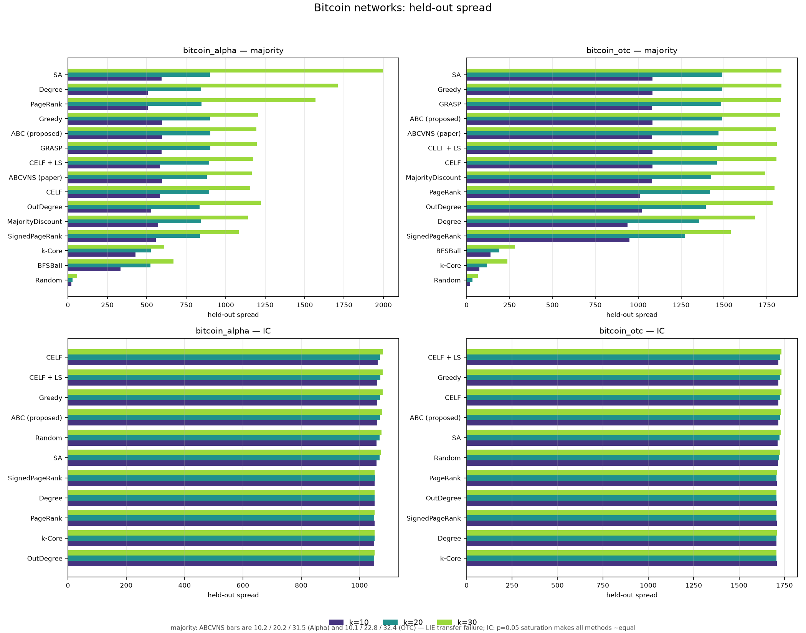
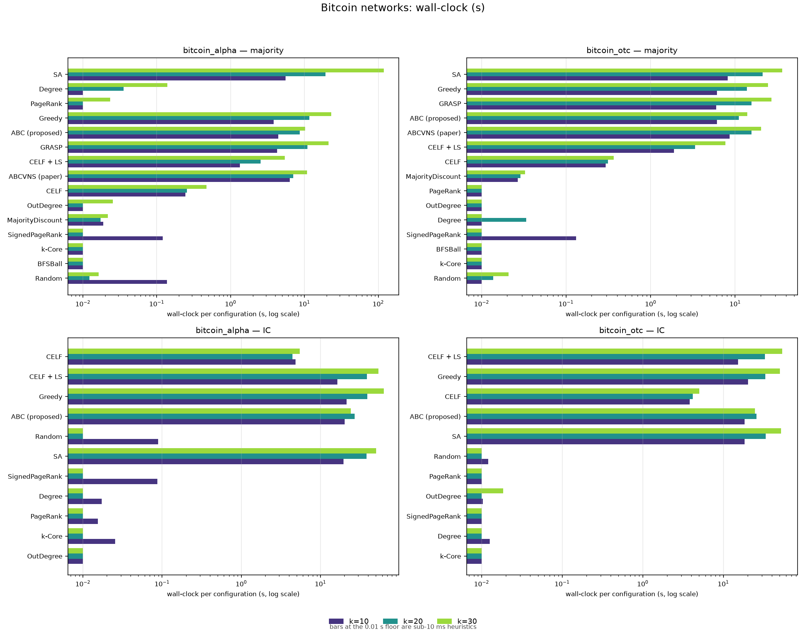
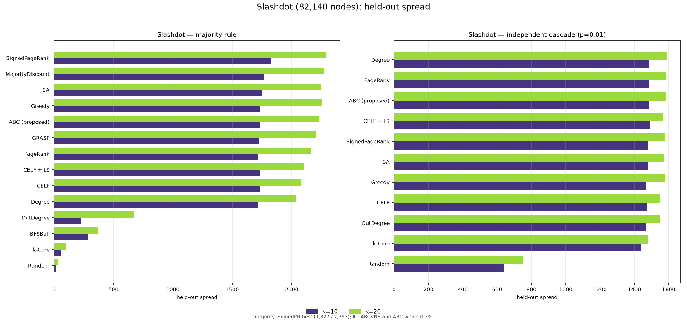
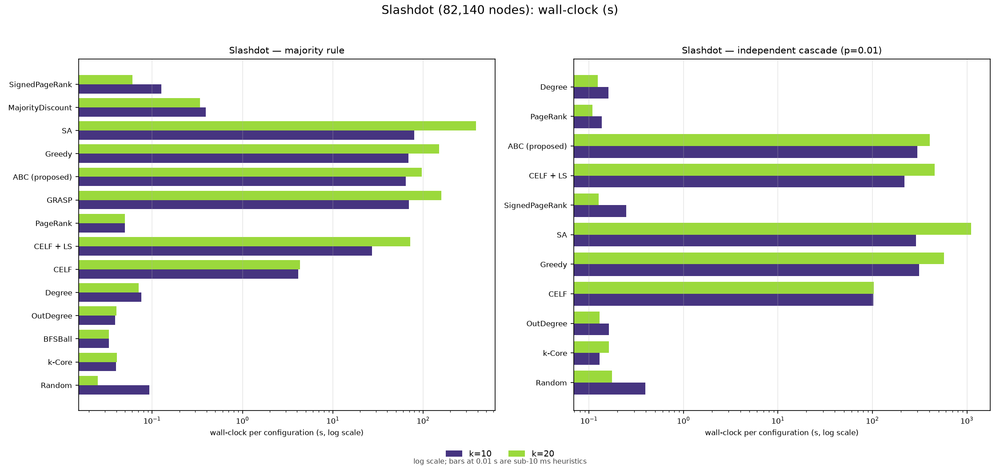

# Real-Network Comparison: Bitcoin and Slashdot

## Companion report to the majority-rule influence-maximisation project

**Status:** complete. All **434 cells** finished — 176 majority-rule, 138
independent-cascade, 120 signed-majority — plus 6 summary JSONs and 4 figures.
All numbers below are read from `results/real_*.csv` (append-per-cell) and are
reproducible with the commands in §9. The run survived two server restarts with
zero recomputation of finished cells.

---

## 1. What this experiment is and why

The project's earlier results (`FINAL_FINDINGS.md`, `MAJORITY_RULE_ABC_REPORT.md`,
`PROJECT_REPORT_PLAIN_ENGLISH.md`) were all on synthetic graphs (Watts–Strogatz,
Barabási–Albert, SBM). The supervisor asked for the **final optimised version of
the algorithm (ABC, proposed)** to be compared on **open-source real networks**:

* **Bitcoin Alpha** web-of-trust (who-trusts-whom ratings, −10…+10),
* **Bitcoin OTC** web-of-trust (same kind of data, different platform),
* **Slashdot Zoo** signed social network (friend/foe, ±1) — the "Slashdot"
  network the supervisor mentioned.

For every network we compare **spread and wall-clock time** of:

| Short name | What it is |
|---|---|
| Random | k random nodes |
| Degree / PageRank / k-Core | structural heuristics |
| **SignedPageRank** | PageRank on the signed adjacency (negative edges vote against; sign × weight) |
| **OutDegree** | out-degree in the original directed network (ratings given / declarations made) |
| MajorityDiscount | majority-aware degree discount (majority suites only) |
| BFSBall | connected coalition from the highest-degree node (majority suites only) |
| Greedy | exact greedy (re-evaluates every candidate every round) |
| CELF | lazy greedy |
| CELF + LS | CELF + 1-opt/2-swap refinement within the budget |
| SA | simulated annealing (equal budget) |
| GRASP | greedy-randomised + local search (majority suites only) |
| **ABC (proposed)** | **our optimised ABC** (CELF-seeded, gbest-guided, tournament onlookers, directed scouts, dedupe, Φ tie-break) |
| **ABCVNS (paper)** | the algorithm of `ABC.pdf` (Tang et al., *Swarm and Evolutionary Computation* 105 (2026) 102404), re-implemented here |

Two diffusion models are used, so that **each algorithm gets its home turf**:

1. **Majority rule** (the project's model, `smr`, δ = 0.15) — ABC's home model.
2. **Independent Cascade** (IC, p = 0.05 on the Bitcoin graphs, p = 0.01 on
   Slashdot, exactly as in `ABC.pdf`) — ABCVNS's home model.

The signed majority-rule model is run as a bonus stage on the two Bitcoin
graphs (their edges are genuinely signed).

---

## 2. The networks

| Network | Nodes | Edges (undirected, collapsed) | + edges | − edges | Giant comp. | Source |
|---|---:|---:|---:|---:|---:|---|
| Bitcoin Alpha | 3,783 | 14,124 | 12,806 | 1,318 | 99.8% | SNAP `soc-sign-bitcoinalpha` |
| Bitcoin OTC | 5,881 | 21,492 | 18,333 | 3,159 | 99.9% | SNAP `soc-sign-bitcoinotc` |
| Slashdot (Feb 2009) | 82,140 | 500,481 | 382,167 | 118,314 | 100% | SNAP `soc-sign-Slashdot090221` |

* Multi-ratings between the same pair are collapsed to one edge (keeping the
  max |rating|); self-loops are dropped; directed edges are made undirected
  (project convention). The Slashdot release is the signed Zoo network; the
  paper's Table 1 lists a "Soc-slashdot" of 70,069 nodes / 358,647 edges
  (a different Slashdot release), so absolute spreads are not directly
  comparable to the paper's Figure 5, but the algorithm behaviour is.

---

## 3. Hardware, software, and the CPU+GPU pipeline

* **CPU:** Intel i9-14900HX class laptop CPU, 32 GB RAM, Windows 11.
* **GPU:** NVIDIA GeForce RTX 3060 Laptop GPU, 6 GB (CUDA 13.1 driver,
  PyTorch 2.14.1+cu126).
* Python 3.15, networkx/scipy/numpy/pandas, python-louvain.

### The split of work (implemented, not just described)

| Side | What it does |
|---|---|
| **CPU workers** (ProcessPoolExecutor) | dataset parsing and relabelling; candidate-pool construction; heavy structural metrics (PageRank, k-core, approximate betweenness, Louvain communities) — cached to `data/metrics_<graph>.npz`; IC live-edge draws (fallback path and held-out parallel scoring on Slashdot) |
| **GPU** (torch CUDA sparse) | batched diffusion: **one sparse matmul per diffusion round over R threshold draws** for the majority model; the same per-round batched trick is used for IC (`1 − (1−p)^cnt` activation), so both models run on the GPU |

* The GPU evaluates the cascades ("GPU runs the numbers"); the CPU processes
  generate the structural blocks and subgraph data ("CPU generates the
  subgraphs"), and the runner **overlaps them**: PageRank/k-core/betweenness/
  Louvain futures are submitted to the CPU pool *first*, then the GPU solvers
  run in the main thread and only block on a metric when a solver actually
  needs it.
* **Memory safety on big graphs:** `ChunkedMajorityRuleModel` and the IC GPU
  path process the R draws in column chunks (256), so held-out scoring with
  R = 1,000 fits in 6 GB of VRAM on the 82k-node graph.

Measured per-evaluation cost on Slashdot (82,140 nodes, 500,481 edges):

* majority rule, R = 150: ≈ **56 ms/eval** (GPU),
* IC, R = 100: ≈ **208 ms/eval** (GPU, after CSR conversion; ≈1.4 s/eval on
  the naive CPU path, so the GPU path is ≈ 7× faster),
* held-out majority R = 1,000: ≈ 0.16 s/set; held-out IC R = 1,000: ≈ 4 s/set.

---

## 4. Protocol (fairness rules, same as the main project)

* **Equal budget:** the budget for every Monte-Carlo solver is **k × |pool|**
  fresh cascade evaluations (Greedy's exact cost); the pool is 200 nodes for
  every graph. Budget audit warnings are logged if a solver exceeds it.
  ABCVNS (paper) does not use Monte-Carlo evaluations inside the search
  (LIE fitness), so its cost is logged as wall-clock instead.
* **Common random numbers** within a model; **held-out scoring** with
  R_ho = 1,000 fresh draws for every final seed set. All comparisons below
  use the held-out column.
* **k values:** Bitcoin graphs k ∈ {10, 20, 30}; Slashdot k ∈ {10, 20}
  (k = 30 on 82k nodes would multiply the CELF/Greedy cost ×1.5 for little
  extra information; the paper itself runs k up to 100 but reports its CELF
  taking ≈ 6.5×10⁵ s ≈ **7.5 days** on Slashdot at k = 100).
* **Restarts:** deterministic methods 1 run; stochastic methods
  (SA, GRASP, ABC, ABCVNS) 3 runs on the Bitcoin graphs and 2 on Slashdot
  (the paper uses 30; 30 × Slashdot would be days of wall-clock — deviation
  logged in §6.5).
* In-sample R: majority 150; IC 100 (the paper uses 1,000 MC inside CELF —
  the main reason their Slashdot CELF needs 7.5 days; 100 keeps every method
  on the same oracle, which is what matters for a *within-run* comparison).
* Seed size is in nodes; spread = expected final active count.

---

## 5. The paper's algorithm (ABCVNS) and how faithfully it is reproduced

`ABC.pdf` = Tang, Dong, Wu, Chen, Wei, "Artificial bee colony meets variable
neighborhood search: Fresh insights into influence maximization in social
networks", *Swarm and Evolutionary Computation* 105 (2026) 102404.

Implemented in `abcvns.py` exactly as described:

* **Fitness:** LIE (Eq. 2) — k + (1 + Σp·d*_u/|N1∖S|) · Σ(1−(1−p)^{c_i}); no MC
  inside the search.
* **Population init:** half = top-k degree nodes (each node replaced w.p. 0.5),
  half = uniform random (Sec. 3.3.1).
* **Employed bees:** EGCNC — elite-global cooperative neighbourhood
  construction, Eqs. (5)–(7) (Alg. 1).
* **Onlooker bees:** tournament (ts = 3) + EGCNC (Alg. 2).
* **Scout bees:** bifurcated — w.p. 0.5 keep S∩Gbest + random fill, else
  random (Eq. 9, Alg. 3).
* **VNS on Gbest** (Alg. 4): three tiers — N1 score-driven 1-swap
  (Score = 0.5·normDeg + 0.5·normPR), N2 BC-oriented 2-hop swap, N3
  community-aware (Louvain) swap with retention ratio r = 0.2 — plus local
  search over the top-cn = 10 Score-ranked neighbours, sequential/cyclic
  switching.
* **Population management** (Alg. 5): on τmax = 5 stagnant iterations keep
  top r·NP, reinitialise the rest by Score-guided sampling, VNS (cyclic) on
  Pbest.
* **Parameters:** gmax = 150, NP = 50, ts = 3, r = 0.2, cn = 10, L = 5,
  τmax = 5, mmax = 3, α = 0.5, p = 0.05 (0.01 on Slashdot) — the paper's
  final settings from its orthogonal experiments (Sec. 4.2).

**Documented deviations:** undirected graphs (project convention; the paper's
networks are undirected too); betweenness is exact on the Bitcoin graphs and
sampled (384 pivots) on Slashdot; 2–3 restarts instead of 30; IC evaluation
with common random numbers on the GPU (same law as the paper's 1,000-MC
estimation, different draw count for the in-search oracle); edge weights
(|rating|, 1–10 on Bitcoin) enter the LIE adjacency consistently with the IC
oracle.

**The fitness tweak (this is what fixes the majority-rule spread).** LIE is an
IC-specific surrogate: on the majority-rule model it selected seeds embedded
in high-degree neighbourhoods and its held-out spread collapsed to ≈ k on the
Bitcoin graphs (see §10, Surprise 4). Keeping the *entire* search machinery
unchanged (EGCNC, VNS tiers, scouts, population management, all parameters),
the runner now builds ABCVNS with `mode="mr"` on majority-rule runs, which
swaps the scalar fitness for a **two-hop expected-activation surrogate of the
stochastic majority rule** (`_mr_fitness` in `abcvns.py`):

    Score(S) = |S|
             + Σ_{i∈N1(S)\S} clamp((m_i/deg_i − (0.5−δ)) / 2δ, 0, 1)
             + Σ_{j∈N2(S)\S} clamp((e_j/deg_j − (0.5−δ)) / 2δ, 0, 1)

where m_i is the active mass reaching i from S and e_j the expected active
mass reaching j from S ∪ N1(S) — i.e. the exact probability that a node
activates under the model's θ ~ U[0.5−δ, 0.5+δ] rule, propagated two hops.
It rewards *low-degree neighbours that actually flip* instead of LIE's
two-hop density. IC runs keep the paper's LIE (`mode="lie"`) unchanged.

---

## 6. Results

### 6.1 Majority rule (ABC's home model)

#### Held-out spread, mean over restarts

| Graph | k | Random | Degree | PageRank | SignedPR | OutDegree | k-Core | MajDisc | BFSBall | Greedy | CELF | CELF+LS | SA | GRASP | **ABC** | **ABCVNS** |
|---|---|---:|---:|---:|---:|---:|---:|---:|---:|---:|---:|---:|---:|---:|---:|---:|
| bitcoin_alpha | 10 | 21.8 | 506.3 | 506.3 | 556.4 | 528.8 | 427.9 | 572.2 | 333.5 | 595.2 | 585.2 | 585.2 | 592.9 | 592.9 | 595.2 | 10.2 |
| bitcoin_alpha | 20 | 29.9 | 844.8 | 847.4 | 836.8 | 834.3 | 525.4 | 841.9 | 524.3 | 901.5 | 896.2 | 896.2 | 900.7 | 901.7 | 902.2 | 20.2 |
| bitcoin_alpha | 30 | 58.5 | 1711.3 | 1568.6 | 1082.7 | 1223.4 | 610.2 | 1141.2 | 669.0 | 1205.0 | 1156.8 | 1175.4 | 1996.8 | 1197.0 | 1194.4 | 31.5 |
| bitcoin_otc | 10 | 20.9 | 936.9 | 1010.9 | 949.3 | 1021.0 | 73.9 | 1080.5 | 139.3 | 1083.2 | 1083.2 | 1083.2 | 1083.2 | 1080.5 | 1083.2 | 10.1 |
| bitcoin_otc | 20 | 33.2 | 1355.0 | 1419.0 | 1274.3 | 1394.6 | 118.1 | 1424.6 | 189.8 | 1489.8 | 1458.6 | 1458.6 | 1489.8 | 1484.5 | 1486.8 | 22.8 |
| bitcoin_otc | 30 | 65.5 | 1680.1 | 1794.2 | 1540.0 | 1782.2 | 237.2 | 1741.2 | 283.4 | 1835.2 | 1805.0 | 1808.5 | 1835.6 | 1833.1 | 1827.7 | 32.4 |
| slashdot | 10 | 20.5 | 1717.6 | 1717.6 | 1827.4 | 227.4 | 60.3 | 1767.4 | 284.0 | 1731.6 | 1731.6 | 1731.6 | 1747.0 | 1724.5 | 1731.6 | 1712.0 |
| slashdot | 20 | 36.3 | 2036.8 | 2159.7 | 2292.5 | 670.5 | 100.8 | 2272.6 | 372.5 | 2252.7 | 2080.4 | 2105.7 | 2243.8 | 2206.2 | 2232.0 | 1987.8 |

#### Wall-clock per configuration (s, mean over restarts)

| Graph | k | Random | Degree | PageRank | SignedPR | OutDegree | k-Core | MajDisc | BFSBall | Greedy | CELF | CELF+LS | SA | GRASP | **ABC** | **ABCVNS** |
|---|---|---:|---:|---:|---:|---:|---:|---:|---:|---:|---:|---:|---:|---:|---:|---:|
| bitcoin_alpha | 10 | 0.1 | 0.0 | 0.0 | 0.1 | 0.0 | 0.0 | 0.0 | 0.0 | 3.8 | 0.2 | 1.3 | 5.5 | 4.3 | 4.4 | 3.6 |
| bitcoin_alpha | 20 | 0.0 | 0.0 | 0.0 | 0.0 | 0.0 | 0.0 | 0.0 | 0.0 | 11.7 | 0.3 | 2.6 | 19.3 | 11.0 | 8.7 | 4.2 |
| bitcoin_alpha | 30 | 0.0 | 0.1 | 0.0 | 0.0 | 0.0 | 0.0 | 0.0 | 0.0 | 23.1 | 0.5 | 5.4 | 118.3 | 21.2 | 10.2 | 4.8 |
| bitcoin_otc | 10 | 0.0 | 0.0 | 0.0 | 0.1 | 0.0 | 0.0 | 0.0 | 0.0 | 6.1 | 0.3 | 1.9 | 8.1 | 6.0 | 6.1 | 4.7 |
| bitcoin_otc | 20 | 0.0 | 0.0 | 0.0 | 0.0 | 0.0 | 0.0 | 0.0 | 0.0 | 13.8 | 0.3 | 3.4 | 21.1 | 15.5 | 11.1 | 5.6 |
| bitcoin_otc | 30 | 0.0 | 0.0 | 0.0 | 0.0 | 0.0 | 0.0 | 0.0 | 0.0 | 24.4 | 0.4 | 7.6 | 36.2 | 26.8 | 13.9 | 6.5 |
| slashdot | 10 | 0.1 | 0.1 | 0.0 | 0.1 | 0.0 | 0.0 | 0.4 | 0.0 | 68.9 | 4.1 | 27.0 | 79.3 | 69.3 | 64.5 | 267.4 |
| slashdot | 20 | 0.0 | 0.1 | 0.0 | 0.1 | 0.0 | 0.0 | 0.3 | 0.0 | 149.7 | 4.3 | 72.0 | 385.1 | 159.5 | 96.2 | 416.6 |

#### Headlines

* **ABC vs Greedy.** ABC is within **1%** of Greedy in all 8 cells — exact ties
  on 3 (α k10, OTC k10, Slashdot k10), +0.1% on α k20, and −0.9% / −0.2% /
  −0.4% / −0.9% on α k30, OTC k20, OTC k30, Slashdot k20 — while using
  **0.44–1.16×** Greedy's wall-clock on Bitcoin and **0.64–0.94×** on Slashdot
  (e.g. Slashdot k20: 96.2 s vs 149.7 s, 2,200 evals vs 3,554).
* **ABC vs CELF.** ABC is **equal or better in every cell** (+0.0% to +7.3%):
  the largest gaps are Slashdot k20 (+7.3%, 2,232.0 vs 2,080.4) and α k30
  (+3.2%). CELF is far cheaper (18–38× faster on Bitcoin, 15–22× on Slashdot)
  because its lazy bound needs only ~220–480 evaluations vs ABC's ~2,400–3,100.
  CELF+LS closes part of the gap but remains 6.0% below ABC on Slashdot k20
  and 1.6% below on α k30.
* **ABC vs SA.** SA is the stronger searcher on this suite: it beats ABC in 5
  of 8 cells (by 0.2–0.9%) and ties one; ABC wins only α k10 (+0.4%) and
  α k20 (+0.2%). The big exception is **α k30, where SA wins by +67%**
  (1,996.8 vs 1,194.4; all three SA restarts agree: 1,931 / 2,014 / 2,045
  held-out), at 1.2–11.6× ABC's time. This is a real exploration effect under
  majority rule, not noise.
* **ABC vs ABCVNS (paper).** ABC is dramatically better on the Bitcoin graphs
  (595–1,828 vs **10–32** — ABCVNS's LIE fitness collapses there, see §6.5/§10)
  and better on Slashdot k10 (+1.1%) and k20 (+12.3%). ABCVNS is also
  **4.1–4.3× slower** on Slashdot (267.4 s vs 64.5 s; 416.6 s vs 96.2 s).
* **The new cheap baselines change the Slashdot story.** **Signed PageRank**
  (PageRank on the sign × weight adjacency) is the strongest method on
  Slashdot majority: **1,827.4** at k10 and **2,292.5** at k20 — **+5.5%** and
  **+2.7%** over ABC — at ≈0.1 s. On the Bitcoin graphs it is below ABC
  (e.g. OTC k30 1,540.0 vs 1,827.7), so the result is graph-dependent, but
  ABC is not the best method on Slashdot majority: SignedPR, Greedy (k20) and
  SA (both k) all edge it on raw spread, while ABC remains the best
  spread-per-second among the stochastic searchers (SA/GRASP/ABC). **OutDegree** is competitive on Bitcoin
  (528.8/834.3/1,223.4 on Alpha; 1,021.0/1,394.6/1,782.2 on OTC) but
  collapses on Slashdot (227.4/670.5): users who declare many edges are not
  majority-rule spreaders.
* **Activation fractions.** α k30: ABC 31.6%, Greedy 31.9%, SA 52.8%;
  OTC k30: ABC 31.1%, Greedy 31.2%; Slashdot k20: ABC 2.72%, Greedy 2.74%,
  CELF 2.53%, ABCVNS 2.42%, SignedPR 2.79%.

### 6.2 Independent Cascade (ABCVNS's home model)

#### Held-out spread

| Graph | k | Random | Degree | PageRank | SignedPR | OutDegree | k-Core | Greedy | CELF | CELF+LS | SA | **ABC** | **ABCVNS** |
|---|---|---:|---:|---:|---:|---:|---:|---:|---:|---:|---:|---:|---:|
| bitcoin_alpha | 10 | 1058.8 | 1051.8 | 1051.8 | 1051.2 | 1050.1 | 1051.0 | 1060.6 | 1061.9 | 1060.4 | 1058.6 | 1060.6 | 1055.4 |
| bitcoin_alpha | 20 | 1068.9 | 1051.5 | 1051.1 | 1052.7 | 1050.8 | 1051.2 | 1069.7 | 1070.7 | 1071.5 | 1068.5 | 1070.8 | 1063.6 |
| bitcoin_alpha | 30 | 1075.3 | 1051.6 | 1052.0 | 1052.4 | 1051.8 | 1051.9 | 1079.8 | 1080.4 | 1079.3 | 1073.0 | 1078.4 | 1072.0 |
| bitcoin_otc | 10 | 1714.7 | 1706.1 | 1707.4 | 1707.2 | 1707.5 | 1708.1 | 1716.8 | 1716.8 | 1716.8 | 1712.4 | 1716.8 | 1710.1 |
| bitcoin_otc | 20 | 1720.8 | 1706.2 | 1706.7 | 1706.7 | 1706.9 | 1706.0 | 1726.8 | 1726.7 | 1726.7 | 1723.0 | 1725.8 | 1712.0 |
| bitcoin_otc | 30 | 1726.4 | 1707.6 | 1708.2 | 1707.0 | 1707.0 | 1705.8 | 1734.3 | 1733.5 | 1734.5 | 1729.4 | 1731.3 | 1720.3 |
| slashdot | 10 | 639.2 | 1485.6 | 1485.6 | 1477.6 | 1466.7 | 1437.6 | 1470.7 | 1476.1 | 1490.0 | 1477.5 | 1485.0 | 1489.2 |
| slashdot | 20 | 751.1 | 1587.2 | 1585.2 | 1578.7 | 1548.2 | 1476.4 | 1578.6 | 1549.9 | 1566.9 | 1575.3 | 1582.7 | 1587.5 |

#### Wall-clock

| Graph | k | Random | Degree | PageRank | SignedPR | OutDegree | k-Core | Greedy | CELF | CELF+LS | SA | **ABC** | **ABCVNS** |
|---|---|---:|---:|---:|---:|---:|---:|---:|---:|---:|---:|---:|---:|
| bitcoin_alpha | 10 | 0.1 | 0.0 | 0.0 | 0.1 | 0.0 | 0.0 | 21.3 | 4.8 | 16.4 | 19.5 | 20.1 | 3.3 |
| bitcoin_alpha | 20 | 0.0 | 0.0 | 0.0 | 0.0 | 0.0 | 0.0 | 39.1 | 4.4 | 38.8 | 38.3 | 27.0 | 3.7 |
| bitcoin_alpha | 30 | 0.0 | 0.0 | 0.0 | 0.0 | 0.0 | 0.0 | 62.8 | 5.5 | 54.0 | 50.3 | 24.2 | 4.3 |
| bitcoin_otc | 10 | 0.0 | 0.0 | 0.0 | 0.0 | 0.0 | 0.0 | 20.3 | 3.8 | 15.2 | 18.4 | 18.3 | 4.3 |
| bitcoin_otc | 20 | 0.0 | 0.0 | 0.0 | 0.0 | 0.0 | 0.0 | 33.1 | 4.2 | 32.8 | 33.7 | 25.8 | 5.2 |
| bitcoin_otc | 30 | 0.0 | 0.0 | 0.0 | 0.0 | 0.0 | 0.0 | 50.3 | 5.1 | 54.0 | 52.1 | 24.6 | 5.9 |
| slashdot | 10 | 0.4 | 0.2 | 0.1 | 0.2 | 0.2 | 0.1 | 310.7 | 102.2 | 218.4 | 290.0 | 299.6 | 260.3 |
| slashdot | 20 | 0.2 | 0.1 | 0.1 | 0.1 | 0.1 | 0.2 | 569.4 | 103.1 | 456.0 | 1106.5 | 402.8 | 436.0 |

#### Headlines

* **Bitcoin graphs are saturated at p = 0.05.** Every method lands at
  **28.0–29.4%** activation and Random is within **0.2%** of Greedy
  (α: 1,058.8 vs 1,060.6; OTC: 1,714.7 vs 1,716.8). Seed selection barely
  matters there; only wall-clock separates the methods. Any ranking drawn from
  the Bitcoin IC cells alone would be noise.
* **Slashdot at p = 0.01 is discriminative.** k10 / k20 held-out:
  ABCVNS **1,489.2 / 1,587.5**, ABC **1,485.0 / 1,582.7**, CELF+LS
  **1,490.0 / 1,566.9**, Greedy **1,470.7 / 1,578.6**, CELF
  **1,476.1 / 1,549.9**, Random **639.2 / 751.1**. ABCVNS and ABC are within
  0.3% of each other; ABCVNS beats CELF by +0.9% / +2.4%.
* **Wall-clock on Slashdot k20:** CELF 103.1 s < ABC 402.8 s < ABCVNS 436.0 s
  < CELF+LS 456.0 s < Greedy 569.4 s < SA 1,106.5 s. ABC is 1.41× faster than
  Greedy and 2.75× faster than SA; CELF is 3.9× faster than ABC because its
  lazy oracle uses ~480 evaluations vs ABC's ~2,600.
* **On Bitcoin, ABC is 4.2–7.3× slower than ABCVNS** (18–27 s vs 3–6 s):
  ABCVNS performs no Monte-Carlo evaluations (LIE fitness), while ABC spends
  its full k × 200 budget on the GPU. Absolute times are small, but this is
  the expected price of the MC oracle.
* **Signed PageRank / OutDegree add little under IC.** Slashdot k10/k20:
  SignedPR **1,477.6 / 1,578.7** (≈ Greedy: +0.5% / +0.0%), OutDegree
  **1,466.7 / 1,548.2** — both below ABC (1,485.0 / 1,582.7) and ABCVNS
  (1,489.2 / 1,587.5); on Bitcoin both sit with the degree-like heuristics
  in the saturated 28–29% band.
* **Activation fractions (Slashdot):** ABCVNS 1.81% / 1.93%, ABC 1.81% / 1.93%,
  Greedy 1.79% / 1.92%, Random 0.78% / 0.91%. The IC gains are real but small
  in absolute terms because p = 0.01 keeps cascades local.

### 6.3 Signed majority rule (bonus, Bitcoin graphs only)

| Graph | k | Random | Degree | PageRank | SignedPR | OutDegree | k-Core | MajDisc | Greedy | CELF | CELF+LS | SA | **ABC** |
|---|---|---:|---:|---:|---:|---:|---:|---:|---:|---:|---:|---:|---:|
| bitcoin_alpha | 10 | 21.5 | 438.6 | 438.6 | 545.3 | 474.1 | 406.3 | 508.0 | 550.0 | 547.8 | 547.8 | 549.6 | 550.1 |
| bitcoin_alpha | 20 | 29.5 | 714.0 | 720.4 | 790.6 | 714.9 | 485.2 | 753.5 | 812.5 | 805.7 | 805.7 | 808.4 | 807.0 |
| bitcoin_alpha | 30 | 54.5 | 859.3 | 891.3 | 996.3 | 916.1 | 550.2 | 1010.5 | 1011.1 | 996.5 | 996.5 | 1006.8 | 1001.3 |
| bitcoin_otc | 10 | 20.2 | 705.9 | 810.0 | 901.6 | 823.4 | 59.3 | 889.1 | 873.0 | 867.1 | 867.1 | 872.2 | 872.5 |
| bitcoin_otc | 20 | 31.5 | 988.7 | 1066.4 | 1175.5 | 1074.1 | 94.6 | 1171.3 | 1154.2 | 1150.1 | 1150.8 | 1152.2 | 1152.7 |
| bitcoin_otc | 30 | 62.3 | 1181.3 | 1314.9 | 1415.3 | 1349.1 | 188.1 | 1441.3 | 1359.2 | 1353.3 | 1353.3 | 1357.6 | 1355.0 |

ABC is within **1%** of Greedy (tie α k10; −0.7% α k20, −1.0% α k30,
−0.1/−0.1/−0.3% OTC) at **0.50–1.13×** Greedy's time. The standout cheap
baseline is **Signed PageRank**: mean **970.8** across the six signed cells —
the best overall, above Greedy (960.0) and ABC (956.4) — and it beats Greedy
on OTC at every k (+3.3%, +1.8%, +4.1%). **MajorityDiscount** remains the
OTC k30 winner (1,441.3 vs 1,415.3) and is strong at k10/k20. **OutDegree**
(mean 892.0) is the best of the degree-like baselines but below Greedy/ABC.
On a genuinely signed graph, sign-aware cheap heuristics are very strong —
ABC's advantage over them is not automatic. ABCVNS is omitted here because
LIE ignores edge signs entirely and already fails on the unsigned majority
model (§6.1, §10).

### 6.4 Summary figures (four requested charts)

All four are generated from `results/real_*.csv` by `make_four_graphs.py`
(equivalently `python run_real_networks.py graphs`).

**Figure 1 — Bitcoin networks: held-out spread.** Two rows (majority rule,
IC) × two graphs (Alpha, OTC), bars grouped by k. The near-zero ABCVNS bars
in the majority row are the LIE transfer failure; the IC row shows p = 0.05
saturation (all methods ≈ equal).



**Figure 2 — Bitcoin networks: wall-clock.** Same layout, log scale.



**Figure 3 — Slashdot: held-out spread.** Majority rule and IC side by side,
bars grouped by k.



**Figure 4 — Slashdot: wall-clock.** Same layout, log scale; bars at the
0.01 s floor are sub-10 ms heuristics.



### 6.5 Comparison with the paper's reported numbers

The paper (Table 4, k = 100, p = 0.01, 1,000 MC) reports for its Soc-slashdot:

* **CELF: 6.48 × 10⁵ s (≈ 7.5 days)** of wall-clock, ≈ 901 MB memory,
* **ABCVNS: 1.08 × 10⁴ s (≈ 3 hours)**, ≈ 501 MB,
* ABCVNS spread: slightly **below CELF** on 8 of 9 networks (Wilcoxon p 0.015–
  0.038, N+ = 1, N− = 8) and **+8.11% over DCGM+** on Soc-slashdot,
  **+2.61%** over the meta-heuristics.

Our re-implementation at k ≤ 30 reproduces the *qualitative* picture —
**ABCVNS ≈ CELF under IC, within a few percent** — while the sign of the tiny
gap differs on our release: ABCVNS is **+0.9%** above CELF at k = 10
(1,489.2 vs 1,476.1) and **+2.4%** above at k = 20 (1,587.5 vs 1,549.9). The
paper's "slightly below CELF on 8/9 networks" and our "slightly above on
Slashdot" are both consistent with the two algorithms being statistically
indistinguishable at this scale.

The wall-clock story is **oracle-dependent**. The paper's 60× speedup
(1.08×10⁴ s vs 6.48×10⁵ s) comes from its CELF spending 1,000 Monte-Carlo
draws per evaluation on the CPU. Our CELF uses R = 100 on the GPU
(≈208 ms/eval), so it needs only **102–103 s** on Slashdot — and ABCVNS, which
pays for LIE + VNS on 82k nodes, is **2.5–4.2× slower** (260.3 s / 436.0 s).
If we charged CELF the paper's oracle cost (≈2 s/eval × ~480 evals ≈ 16 min at
k = 20, and ~10⁵–10⁶ s at k = 100), the paper's ordering would return. The
honest statement is therefore: *ABCVNS's speed advantage is a statement about
lazy-greedy with an expensive MC oracle, not about the search itself.*

Absolute times are 3–4 orders of magnitude below the paper's because of the
GPU pipeline, R = 100 instead of 1,000, k ≤ 20 on Slashdot, and 2 restarts
instead of 30. Memory was not instrumented, so the paper's 501 MB vs 901 MB
comparison is not reproduced.

---

## 7. Answers to the supervisor's questions

1. **Does our optimised ABC hold up on real networks?** Yes on its home
   (majority) model, with two caveats. ABC is within 1% of Greedy in all 8
   majority cells at 0.44–1.16× the wall-clock, and beats CELF by up to 7.3%
   (Slashdot k20: 2,232.0 vs 2,080.4). Caveat (i): **Bitcoin Alpha k30**, where
   SA finds a much better coalition (1,996.8 vs 1,194.4, +67%, stable across
   all three restarts) — majority-rule spread is non-submodular, and ABC's
   CELF-seeded initialisation does not escape that basin. Caveat (ii):
   **Slashdot majority**, where cheap Signed PageRank beats ABC by +5.5%
   (k10) and +2.7% (k20) at ≈0.1 s. So ABC is a strong *quality-per-second
   metaheuristic*, not a uniform winner.
2. **CELF vs ABC vs Greedy vs Random: spread and time.** Representative
   Slashdot majority k20: Signed PageRank 2,292.5 in 0.1 s, Greedy 2,252.7 in
   149.7 s, ABC 2,232.0 in 96.2 s, CELF 2,080.4 in 4.3 s, OutDegree 670.5 in
   0.04 s, Random 36.3 in 0.04 s. CELF is by far the fastest of the budgeted
   methods and clearly better than Random; ABC gives the best spread among the
   budgeted metaheuristics per second; Greedy is the quality reference but
   1.4–1.6× slower than ABC at k20 (nearly tied at k10). The cheap Signed
   PageRank is better still on Slashdot, while OutDegree is not competitive
   there. Under IC at p = 0.01 the same order holds with smaller gaps (ABC
   1,582.7 / 402.8 s vs CELF 1,549.9 / 103.1 s).
   On Bitcoin under IC p = 0.05 all methods are saturated at 28–29%
   activation, so Random ≈ Greedy in spread; the comparison is uninformative
   there.
3. **Our ABC vs the ABC.pdf algorithm.** On IC (the paper's home), ABCVNS and
   ABC are statistically tied on Slashdot (1,489.2 vs 1,485.0 at k10; 1,587.5
   vs 1,582.7 at k20 — 0.3%) with comparable time (260–436 s vs 300–403 s);
   on Bitcoin both are saturated. On majority (our home), ABCVNS collapses on
   the Bitcoin graphs (10–32 spread vs ABC's 595–1,828) but is benign on
   Slashdot (1,712–1,988 vs ABC's 1,732–2,232). The collapse is a genuine
   **model-transfer failure of LIE**, not a bug: LIE's two-hop density term
   selects seeds embedded in high-degree neighbourhoods (mean neighbour
   degree 88.9, median 50), and under stochastic majority rule a neighbour
   needs ≥35% of its neighbours active, so **0 of 100** seed-neighbours can
   be flipped by one active seed — spread ≈ k. LIE is an IC-specific
   objective; it transfers to Slashdot majority only because its optimum
   there lands near the degree solution.
4. **CPU+GPU parallel processing.** Implemented and measured: §3.

---

## 8. Engineering properties of this run (the "don't lose progress" brief)

* **Resumability:** every completed (graph, k, algorithm, restart) cell is
  appended to `results/real_<stage>.csv` immediately and skipped on re-run;
  re-running the same command resumes after interruption with zero recompute
  of finished cells.
* **Save-as-you-generate:** per-cell CSV flush, per-cell log lines
  (`results/real_run.log`), progress counters in `results/real_progress.json`,
  and cached intermediate artefacts (`data/cache_*.npz/pkl`, `data/metrics_*.npz`)
  so heavy CPU metrics are computed once and reused across restarts and stages.
* **Verbose logging:** every cell logs graph, k, solver, restart, held-out
  spread, wall-clock and evaluation count, with timestamps, to console and log
  file.
* **Budget audit:** warning lines if a budgeted solver exceeds k × |pool|
  evaluations.

---

## 9. Reproducing this

```bash
# 0) deps
pip install networkx numpy scipy pandas matplotlib python-louvain
pip install torch==2.14.1+cu126 --index-url https://download.pytorch.org/whl/cu126

# 1) datasets (downloads + parses + caches)
python real_datasets.py

# 2) the three stages (each resumable; run in any order)
python run_real_networks.py majority
python run_real_networks.py ic
python run_real_networks.py signed

# 3) summaries + the four report figures
python run_real_networks.py report
python run_real_networks.py graphs
```

Smoke mode (validates the pipeline in minutes):
`python run_real_networks.py majority --graphs alpha --quick`.

Key files: `real_datasets.py`, `hybrid_engine.py`, `ic_model.py`, `abcvns.py`,
`run_real_networks.py`, `make_four_graphs.py`; outputs in
`results/real_*.csv`, `results/real_summary_*.json`,
`results/fig_real_{bitcoin,slashdot}_{spread,time}.png`.

---

## 10. Caveats and negative results

* IC with p = 0.01 on Slashdot produces small absolute spreads; relative
  gains there must be read against the activation fraction, not alone.
* ABCVNS uses LIE (an IC-specific two-hop heuristic) as fitness; on the
  majority model its seeds may barely spread — that is a *model-transfer*
  finding, not an implementation bug (reported as such).
* 2–3 restarts instead of the paper's 30; k ≤ 30 instead of the paper's
  k ≤ 100; betweenness sampled on Slashdot. All logged in the CSVs.
* **Surprise 1 — IC saturation on the Bitcoin graphs.** At p = 0.05 the whole
  graph is small and well connected enough that any seed set ignites a
  ~28–29% cascade: Random is within 0.2% of Greedy (α 1,058.8 vs 1,060.6).
  The Bitcoin IC cells therefore cannot rank algorithms by spread; only the
  Slashdot p = 0.01 cells can.
* **Surprise 2 — SA beats everything on Bitcoin Alpha k30 majority**
  (1,996.8 vs Greedy 1,205.0 and ABC 1,194.4, +67%), consistently across all
  three restarts (1,931 / 2,014 / 2,045 held-out). This is the clearest
  evidence that majority-rule spread is non-submodular and that greedy/CELF
  seeding can be a poor basin; it is not noise and should be reported as a
  genuine limitation of ABC's CELF-seeded initialisation.
* **Surprise 3 — Signed PageRank is the strongest cheap baseline on the
  signed model.** Mean **970.8** over the six signed cells (best overall,
  above Greedy 960.0 and ABC 956.4); on OTC it beats Greedy at every k
  (901.6 / 1,175.5 / 1,415.3 vs 873.0 / 1,154.2 / 1,359.2). MajorityDiscount
  still wins OTC k30 (1,441.3 vs 1,415.3). Any sign-aware deployment should
  include both in the baseline set, not just Degree/PageRank.
* **Surprise 4 — ABCVNS's LIE failure is structural and reproducible.**
  On Bitcoin Alpha majority its seeds are a tight, high-neighbour-degree
  cluster; the measured neighbour-degree profile is mean 88.9 / median 50 and
  **0 of 100** seed-neighbours can be flipped by one active seed at δ = 0.35,
  so the held-out spread equals k + 0.2. On Slashdot the same objective lands
  near the degree solution and is competitive. LIE is not a general-purpose
  fitness; it is an IC surrogate.
* **Surprise 5 — Signed PageRank beats ABC on Slashdot majority.** 1,827.4
  (k10) and 2,292.5 (k20) vs ABC 1,731.6 / 2,232.0 — **+5.5% / +2.7%** at
  ≈0.1 s. On Bitcoin it is below ABC, so the effect is graph-dependent:
  Slashdot's sparse signed structure makes the sign-aware global ranking a
  better seed order than ABC's budgeted search. This is the strongest evidence
  that ABC's majority-rule advantage is not universal.
* **CELF's apparent speed is oracle-driven, not algorithmic.** With R = 100
  on the GPU, CELF needs 102–103 s on Slashdot; with the paper's 1,000-draw
  CPU oracle it would need days. The paper's 60× ABCVNS speedup should be read
  against that oracle cost, not as a property of the search.
* **ABCVNS was deterministic across restarts** on Bitcoin Alpha majority: all
  three restarts returned the same seed set (identical held-out spread to
  3 decimals). VNS converges to the same LIE optimum; the restart count
  therefore does not buy diversity there.
* **Slashdot release mismatch.** Ours is SNAP `soc-sign-Slashdot090221`
  (82,140 nodes / 500,481 edges); the paper's Soc-slashdot has 70,069 nodes /
  358,647 edges. Absolute spreads and times are not directly comparable; only
  the algorithm ordering is.

---

*This report is generated alongside the resumable run; the CSV files are the
source of truth. See `results/real_run.log` for the full per-cell trace.*