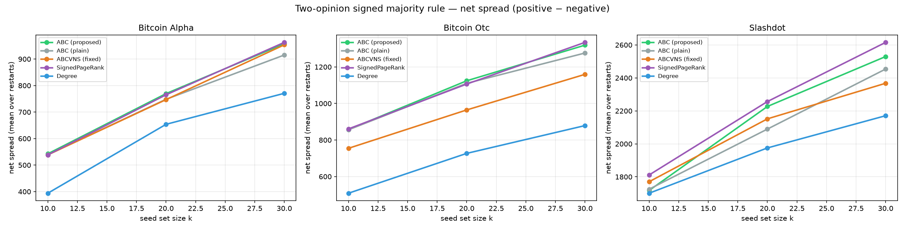
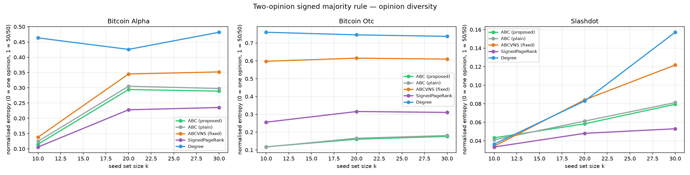
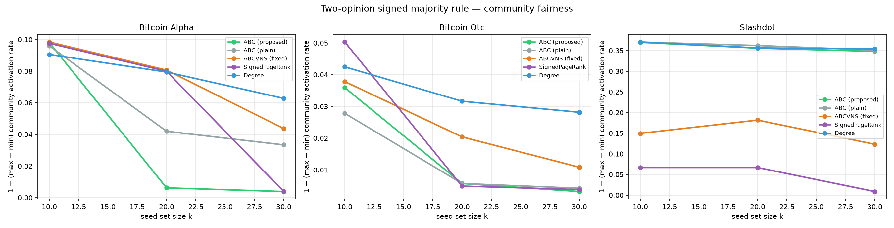
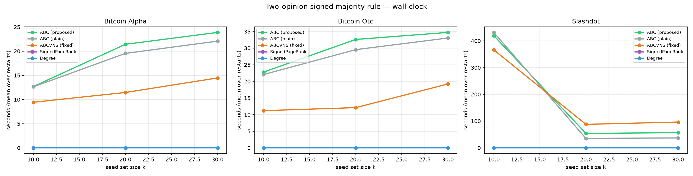

# Corrected Two-Opinion Signed Majority Rule — Results

Total cells: **117** (3 graphs × 3 k × 13 runs; ABC×3, ABC-plain×3, ABCVNS-fixed×5, baselines×1). Draws: R_fit=30 (search), R_ho=300 (held-out).

## Model and metrics

- Nodes end in one of three states: **+1 (positive-active), -1 (negative-active), 0 (inactive)**. Seeds are planted +1.
- Influence of an active neighbour: `sign(edge) × opinion(neighbour) × weight` — negative edges **flip** the opinion they carry.
- A node activates when `|net support| > θ·deg`, θ ~ U[0.35, 0.65], and takes the support's sign (progressive).
- **pos/neg spread**: mean number of nodes ending +1 / −1; **net** = pos − neg (all held-out, mean over restarts).
- **diversity**: normalised Shannon entropy of final opinions among active nodes (0 = one opinion, 1 = exact 50/50).
- **fairness**: 1 − (max − min) community activation rate over communities with ≥10 nodes (1 = evenly reached communities).
- **time**: wall-clock seconds per run (mean over restarts).

## Notes

- **Backend:** Bitcoin cells and Slashdot k=10 ABC cells ran on numpy CPU (Smart App Control was blocking torch); the remaining Slashdot cells ran on GPU after the block was lifted. CPU and GPU produce **identical spreads** (verified: integer weights make the float sums exact), so only the time tables are affected — Slashdot k=10 times are CPU timings, k=20/30 are GPU.
- **Restart counts:** ABC (proposed) 3, ABC (plain) 3, ABCVNS (fixed) 5, baselines 1 (restarts don't apply to them).

## Headline observations

1. **Our ABC beats original ABC on net spread at every graph and every k** (e.g. Alpha k=30: 958.0 ± 5.0 vs 915.2 ± 19.8), with lower variance across restarts.
2. **Optimising positive spread alone can backfire on net:** ABCVNS (fixed) achieves top-tier positive spread but drags 154–248 negative nodes on OTC, ending 10–13 % below ABC in net spread. ABC's held-out Monte-Carlo selection keeps negative spread at 14–37 instead.
3. **SignedPageRank is the strongest baseline:** best net spread on OTC (k=10, k=30) and on all of Slashdot — but it never wins on Bitcoin Alpha, and its ranking is static (one PageRank, then top-k), so it cannot adapt the seed set to cascade feedback.
4. **Degree centrality trades spread for opinion variety:** highest diversity everywhere (0.46–0.76) but the lowest net spread on every graph (e.g. OTC k=30: 879 vs 1319 for ABC).
5. **Diversity and spread are in tension:** ABC (proposed) concentrates the cascade in one opinion (diversity 0.12–0.18 on OTC) — good for net spread, narrow for opinion coverage.

## Charts

## Bitcoin Alpha

### Net spread (positive − negative)

| Algorithm | k=10 | k=20 | k=30 |
|---|---|---|---|
| ABC (proposed) | 542.7 ± 1.1 | 769.7 ± 2.6 | 958.0 ± 5.0 |
| ABC (plain) | 539.2 ± 3.6 | 748.3 ± 15.5 | 915.2 ± 19.8 |
| ABCVNS (fixed) | 538.5 ± 0.8 | 747.0 ± 13.1 | 953.6 ± 7.3 |
| SignedPageRank | 538.6 | 765.2 | 962.9 |
| Degree | 394.0 | 653.8 | 770.8 |

### Positive spread

| Algorithm | k=10 | k=20 | k=30 |
|---|---|---|---|
| ABC (proposed) | 551.4 ± 0.4 | 814.2 ± 2.4 | 1011.9 ± 3.7 |
| ABC (plain) | 548.8 ± 2.9 | 794.1 ± 14.3 | 969.2 ± 18.2 |
| ABCVNS (fixed) | 549.4 ± 0.2 | 802.5 ± 8.3 | 1026.5 ± 5.1 |
| SignedPageRank | 546.4 | 795.7 | 1003.0 |
| Degree | 442.2 | 722.5 | 872.2 |

### Negative spread

| Algorithm | k=10 | k=20 | k=30 |
|---|---|---|---|
| ABC (proposed) | 8.7 ± 1.5 | 44.6 ± 1.1 | 54.0 ± 1.5 |
| ABC (plain) | 9.6 ± 2.7 | 45.7 ± 2.5 | 53.9 ± 3.1 |
| ABCVNS (fixed) | 10.9 ± 1.0 | 55.5 ± 6.0 | 72.9 ± 2.3 |
| SignedPageRank | 7.8 | 30.5 | 40.2 |
| Degree | 48.2 | 68.7 | 101.4 |

### Diversity (opinion entropy)

| Algorithm | k=10 | k=20 | k=30 |
|---|---|---|---|
| ABC (proposed) | 0.115 ± 0.016 | 0.294 ± 0.005 | 0.289 ± 0.006 |
| ABC (plain) | 0.125 ± 0.027 | 0.305 ± 0.014 | 0.298 ± 0.014 |
| ABCVNS (fixed) | 0.138 ± 0.010 | 0.345 ± 0.027 | 0.352 ± 0.008 |
| SignedPageRank | 0.106 | 0.228 | 0.235 |
| Degree | 0.463 | 0.426 | 0.482 |

### Fairness (community balance)

| Algorithm | k=10 | k=20 | k=30 |
|---|---|---|---|
| ABC (proposed) | 0.098 ± 0.001 | 0.006 ± 0.000 | 0.004 ± 0.000 |
| ABC (plain) | 0.096 ± 0.002 | 0.042 ± 0.032 | 0.033 ± 0.024 |
| ABCVNS (fixed) | 0.098 ± 0.001 | 0.081 ± 0.002 | 0.044 ± 0.003 |
| SignedPageRank | 0.098 | 0.080 | 0.004 |
| Degree | 0.091 | 0.079 | 0.063 |

### Time (seconds / run)

| Algorithm | k=10 | k=20 | k=30 |
|---|---|---|---|
| ABC (proposed) | 12.7 ± 0.3 | 21.4 ± 0.4 | 23.9 ± 0.7 |
| ABC (plain) | 12.6 ± 0.3 | 19.5 ± 0.7 | 22.1 ± 0.5 |
| ABCVNS (fixed) | 9.4 ± 0.4 | 11.5 ± 0.5 | 14.5 ± 0.8 |
| SignedPageRank | 0.0 | 0.0 | 0.0 |
| Degree | 0.0 | 0.0 | 0.0 |

## Bitcoin OTC

### Net spread (positive − negative)

| Algorithm | k=10 | k=20 | k=30 |
|---|---|---|---|
| ABC (proposed) | 857.3 ± 1.8 | 1124.2 ± 2.4 | 1319.2 ± 2.3 |
| ABC (plain) | 855.9 ± 3.7 | 1110.4 ± 7.8 | 1276.2 ± 25.5 |
| ABCVNS (fixed) | 754.7 ± 8.0 | 964.7 ± 20.0 | 1159.4 ± 16.7 |
| SignedPageRank | 860.9 | 1106.3 | 1334.4 |
| Degree | 508.9 | 726.9 | 879.0 |

### Positive spread

| Algorithm | k=10 | k=20 | k=30 |
|---|---|---|---|
| ABC (proposed) | 871.4 ± 2.1 | 1152.0 ± 2.4 | 1356.1 ± 2.1 |
| ABC (plain) | 869.9 ± 4.2 | 1139.1 ± 7.4 | 1313.2 ± 25.3 |
| ABCVNS (fixed) | 909.1 ± 6.9 | 1175.7 ± 15.0 | 1407.8 ± 10.1 |
| SignedPageRank | 901.5 | 1177.7 | 1418.4 |
| Degree | 709.1 | 995.0 | 1191.8 |

### Negative spread

| Algorithm | k=10 | k=20 | k=30 |
|---|---|---|---|
| ABC (proposed) | 14.1 ± 0.2 | 27.8 ± 0.0 | 36.9 ± 0.2 |
| ABC (plain) | 14.0 ± 0.5 | 28.6 ± 0.5 | 37.0 ± 3.6 |
| ABCVNS (fixed) | 154.4 ± 1.1 | 211.0 ± 5.6 | 248.4 ± 9.7 |
| SignedPageRank | 40.6 | 71.4 | 84.0 |
| Degree | 200.2 | 268.1 | 312.9 |

### Diversity (opinion entropy)

| Algorithm | k=10 | k=20 | k=30 |
|---|---|---|---|
| ABC (proposed) | 0.118 ± 0.001 | 0.161 ± 0.000 | 0.176 ± 0.001 |
| ABC (plain) | 0.117 ± 0.003 | 0.166 ± 0.003 | 0.181 ± 0.014 |
| ABCVNS (fixed) | 0.598 ± 0.005 | 0.615 ± 0.012 | 0.610 ± 0.013 |
| SignedPageRank | 0.256 | 0.316 | 0.311 |
| Degree | 0.760 | 0.746 | 0.737 |

### Fairness (community balance)

| Algorithm | k=10 | k=20 | k=30 |
|---|---|---|---|
| ABC (proposed) | 0.036 ± 0.003 | 0.006 ± 0.000 | 0.003 ± 0.000 |
| ABC (plain) | 0.028 ± 0.006 | 0.006 ± 0.000 | 0.004 ± 0.002 |
| ABCVNS (fixed) | 0.038 ± 0.001 | 0.020 ± 0.001 | 0.011 ± 0.001 |
| SignedPageRank | 0.050 | 0.005 | 0.004 |
| Degree | 0.042 | 0.032 | 0.028 |

### Time (seconds / run)

| Algorithm | k=10 | k=20 | k=30 |
|---|---|---|---|
| ABC (proposed) | 22.8 ± 0.7 | 32.6 ± 0.2 | 34.7 ± 0.5 |
| ABC (plain) | 22.1 ± 0.6 | 29.5 ± 0.8 | 33.0 ± 0.3 |
| ABCVNS (fixed) | 11.2 ± 0.2 | 12.1 ± 0.4 | 19.2 ± 1.0 |
| SignedPageRank | 0.0 | 0.0 | 0.0 |
| Degree | 0.0 | 0.0 | 0.0 |

## Slashdot

### Net spread (positive − negative)

| Algorithm | k=10 | k=20 | k=30 |
|---|---|---|---|
| ABC (proposed) | 1717.4 ± 23.9 | 2226.8 ± 23.5 | 2529.6 ± 5.3 |
| ABC (plain) | 1725.1 ± 17.9 | 2089.6 ± 94.3 | 2453.8 ± 49.0 |
| ABCVNS (fixed) | 1770.4 ± 56.3 | 2151.7 ± 71.0 | 2367.6 ± 55.0 |
| SignedPageRank | 1811.3 | 2256.6 | 2615.6 |
| Degree | 1700.7 | 1975.3 | 2170.8 |

### Positive spread

| Algorithm | k=10 | k=20 | k=30 |
|---|---|---|---|
| ABC (proposed) | 1725.7 ± 24.0 | 2242.2 ± 20.5 | 2555.0 ± 5.9 |
| ABC (plain) | 1732.9 ± 18.1 | 2105.5 ± 99.4 | 2479.1 ± 48.1 |
| ABCVNS (fixed) | 1776.9 ± 56.3 | 2174.9 ± 70.6 | 2408.4 ± 50.9 |
| SignedPageRank | 1817.7 | 2268.9 | 2631.6 |
| Degree | 1707.3 | 1996.2 | 2222.8 |

### Negative spread

| Algorithm | k=10 | k=20 | k=30 |
|---|---|---|---|
| ABC (proposed) | 8.2 ± 0.1 | 15.4 ± 4.6 | 25.3 ± 1.2 |
| ABC (plain) | 7.8 ± 1.2 | 15.9 ± 11.8 | 25.3 ± 1.4 |
| ABCVNS (fixed) | 6.4 ± 0.1 | 23.1 ± 0.4 | 40.8 ± 9.5 |
| SignedPageRank | 6.4 | 12.3 | 16.0 |
| Degree | 6.7 | 20.9 | 52.0 |

### Diversity (opinion entropy)

| Algorithm | k=10 | k=20 | k=30 |
|---|---|---|---|
| ABC (proposed) | 0.043 ± 0.000 | 0.058 ± 0.015 | 0.079 ± 0.003 |
| ABC (plain) | 0.041 ± 0.005 | 0.061 ± 0.036 | 0.081 ± 0.005 |
| ABCVNS (fixed) | 0.034 ± 0.001 | 0.084 ± 0.003 | 0.122 ± 0.023 |
| SignedPageRank | 0.033 | 0.048 | 0.053 |
| Degree | 0.036 | 0.083 | 0.157 |

### Fairness (community balance)

| Algorithm | k=10 | k=20 | k=30 |
|---|---|---|---|
| ABC (proposed) | 0.370 ± 0.003 | 0.356 ± 0.001 | 0.348 ± 0.001 |
| ABC (plain) | 0.371 ± 0.005 | 0.362 ± 0.008 | 0.351 ± 0.002 |
| ABCVNS (fixed) | 0.150 ± 0.132 | 0.182 ± 0.157 | 0.123 ± 0.126 |
| SignedPageRank | 0.067 | 0.067 | 0.009 |
| Degree | 0.371 | 0.356 | 0.354 |

### Time (seconds / run)

| Algorithm | k=10 | k=20 | k=30 |
|---|---|---|---|
| ABC (proposed) | 419.7 ± 1.0 | 54.1 ± 0.3 | 56.7 ± 0.3 |
| ABC (plain) | 431.6 ± 4.8 | 35.3 ± 0.8 | 37.1 ± 0.9 |
| ABCVNS (fixed) | 366.4 ± 274.4 | 87.9 ± 2.3 | 96.4 ± 3.2 |
| SignedPageRank | 0.0 | 0.0 | 0.0 |
| Degree | 0.0 | 0.0 | 0.0 |

